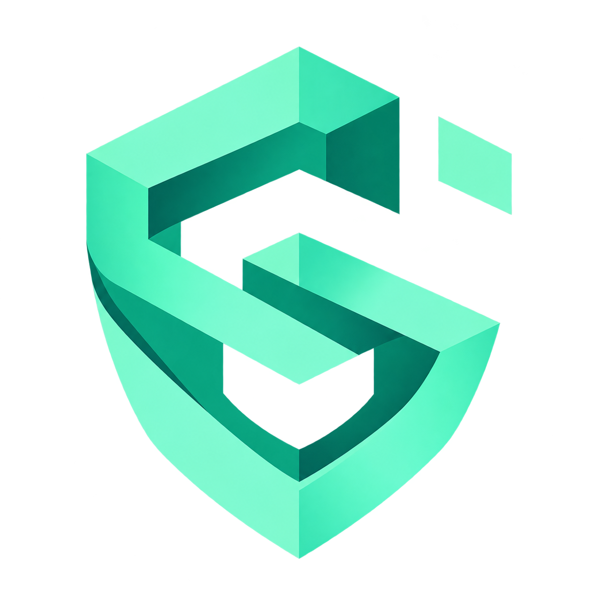
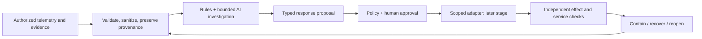

<p align="center">
  <a href="https://lumoslab-innovation.github.io/OpenShieldAI/"></a>
</p>

<h1 align="center">OpenShieldAI</h1>
<p align="center"><strong>Evidence-grounded AI defense, incident response and recovery.</strong></p>
<p align="center">Prepare · Investigate · Respond · Verify recovery</p>

<p align="center">
  <a href="https://lumoslab-innovation.github.io/OpenShieldAI/">Vision &amp; architecture</a> ·
  <a href="#measured-benchmarks">Benchmarks</a> ·
  <a href="docs/research/AI_DEFENSE_EVIDENCE.md">Research</a> ·
  <a href="docs/ROADMAP.md">Roadmap</a> ·
  <a href="CONTRIBUTING.md">Contribute</a>
</p>

<p align="center">
  <a href="docs/ROADMAP.md"></a>
  <a href="LICENSE"></a>
  <a href="docs/SECURITY_GUARDRAILS.md"></a>
  <a href="https://github.com/LumosLab-Innovation/OpenShieldAI/actions/workflows/docs.yml"></a>
</p>

<p align="center">
  <a href="https://github.com/LumosLab-Innovation/OpenShieldAI/stargazers"></a>
  <a href="https://github.com/LumosLab-Innovation/OpenShieldAI/forks"></a>
  <a href="https://github.com/LumosLab-Innovation/OpenShieldAI/graphs/contributors"></a>
</p>

> **Current status — experimental synthetic runtime and isolated lab.** Python/SQLite investigation, exact lab approvals and a CLIProxyAPI/Codex adapter now exist. Caddy/Coraza and restic run in an isolated synthetic fixture. This is not production protection or an accepted S2/S3 pilot. Actual CLIProxyAPI/Codex comparison trials now run separately; their outcomes and limitations belong to the [next-wave measurement record](docs/lab/NEXT_WAVE_RESULTS.md). An available model route does not establish AI benefit. See [runtime instructions](docs/RUNTIME.md), [first-lab measurements](docs/lab/RESULTS.md) and [independent review](docs/lab/EFFICACY_REVIEW.md).

## Measured benchmarks

**Recorded 2026-10-24 · owned synthetic experiments · no accepted production pilot.** These are captured measurements, not a live dashboard. The [landing benchmark section](https://lumoslab-innovation.github.io/OpenShieldAI/#benchmarks) presents the same evidence. Assertions, authored regression cases and independently observed effects have different denominators; their totals must not be combined into an attack-prevention percentage.

### Real AI versus no AI

Sixteen public engineering cases contain four observed harmful effects, four benign workloads and eight unknowns. Both arms receive the same accepted facts, source roles, read catalog and **zero mutation capabilities**. Labels and scenario narratives stay outside prompts. The actual configured alias is `gpt-6.1-sol` through CLIProxyAPI 8.0.41; upstream identity is proxy-reported. [Protocol, interpretation and reproduction](docs/lab/NEXT_WAVE_RESULTS.md) · [final raw record](docs/lab/evidence/next-wave.json) · [frozen corpus](docs/lab/evidence/next-wave-corpus.json).

| Final registered metric | Deterministic baseline v1 | Actual Codex |
|---|---:|---:|
| Valid completed decisions | 16/16 | 16/16 |
| Policy-acceptable assessments | 16/16 | 16/16 |
| Supported-effect cases identified | 4/4 | 4/4 |
| False suspicious among four benign cases | 0/4 | 0/4 |
| Correct unknown outcomes | 8/8 | 8/8 |
| Decisive benign / benign abstentions | 2 / 2 | 4 / 0 |
| Acceptable next-step proposals | 12/16 | 16/16 |
| Registered required-code presence | 13/16 | 14/16 |
| Degraded cases | 0 | 0 |
| Model calls | 0 | 41 |
| Conservative reserved visible tokens | 0 | 171,631 |
| Triage-arm wall time | 4.078 s | 318.469 s |

**Assessment quality ties; operational AI benefit remains unproven.** The four proposal gains concern three failed-recovery escalations and one missing-source escalation. The stronger deterministic comparison below closes them. Required-code presence is not semantic precision, and decisive benign decisions have not been validated in a human trial. Inputs include already observed control outcomes; this is a public regression, not held-out detection accuracy. Enforcement is identical with and without AI. Reserved tokens are conservative gateway accounting, not billed tokens or complete provider/account usage.

The separate [rules + lookup v2 comparator](docs/lab/BASELINE_V2_RESULTS.md) adds failed-restore and visibility-gap escalation rules, with no new observations or authority. It was **tuned after examining this public regression**; v1 and the real AI record remain unchanged. [V2 raw record](docs/lab/evidence/baseline-v2.json).

| Post-hoc public comparison | Baseline v1, retained | Rules + lookup v2 | Codex, retained |
|---|---:|---:|---:|
| Policy-acceptable assessments | 16/16 | 16/16 | 16/16 |
| Acceptable next-step proposals | 12/16 | 16/16 | 16/16 |
| Registered required-code presence | 13/16 | 16/16 | 14/16 |
| Decisive benign / benign abstentions | 2 / 2 | 2 / 2 | 4 / 0 |
| Model calls | 0 | 0 | 41 |

V2 retains 4/4 supported-effect identifications, 0/4 false suspicious benign outcomes and 8/8 unknowns. Its single pass took 2.375 s through a direct-function/SQLite harness that omits Supervisor persistence; this is **not a matched speedup comparison** with the historical v1/AI times. Eight focused tests exercise the added rules and isolation. V2 retains historical restore failures for human review even after a later verified observation; it does not reconcile current restoration readiness. Closing these public proposal checks does not prove v2 generalizes or AI has no value; a fresh ambiguous corpus and operator trial remain necessary.

All attempts remain visible; protocol repairs used the same corpus and scoring. Earlier source hashes identify those runs, but the intermediate source versions were not separately committed. The final source is reproducible; exact upstream model behavior is not guaranteed.

| Completed 16-case AI trial | Valid / degraded | Calls | Reserved tokens | AI-arm wall time |
|---|---:|---:|---:|---:|
| [Original catalog projection](docs/lab/evidence/next-wave-first.json) | 3 / 13 | 25 | 93,386 | 165.141 s |
| [Catalog repair; read-round failures](docs/lab/evidence/next-wave-catalog-fixed.json) | 3 / 13 | 42 | 166,021 | 308.313 s |
| [Final bounded-round protocol](docs/lab/evidence/next-wave.json) | 16 / 0 | 41 | 171,631 | 318.469 s |

The earlier 48-case run stopped on a local cleanup error before a scored artifact; full usage is unknown. A separate [one-case diagnostic](docs/lab/evidence/proxy-diagnostic.json) diagnosed the adapter contract and is unscored. [Complete attempt manifest](docs/lab/evidence/next-wave-trials.json).

### Actual defensive effects and recovery

The controls below run independently of an LLM. Each row links its scope, negative controls and raw observations; a passing fixture does not establish protection for a different deployment.

| Experiment | Measured comparison / useful work | Boundary and evidence |
|---|---|---|
| Request prevention, historical Docker lab | Three planted patterns reach harmful operations with Off/DetectionOnly; On returns 403 with zero app reach/harm. Nine benign requests return 200 across the three modes | Request-rule subset only; planted effects, not demonstrated SQLi/XSS/RCE. [Report](docs/lab/RESULTS.md), [raw](docs/lab/evidence/prevention.json) |
| Approved ingress response, historical Docker lab | 5.532 s source-to-verified-effect; **11 additional planted effects** during response. Three post-maintenance requests return 503; approved reopening returns 200 | Scripted approval; human time unmeasured. In-flight/background activity continues. [Report](docs/lab/RESULTS.md), [runtime raw](docs/lab/evidence/approved-runtime-response.json), [direct-control raw](docs/lab/evidence/response.json) |
| Isolated restic recovery, historical Docker lab | 3.162 s restore-to-usable-app check; synthetic RPO 5.348 s / one transaction. Missing/wrong key, corrupt pack, contaminated and inconsistent snapshots fail | One actual drill; no production RPO/RTO or eradication guarantee. [Report](docs/lab/RESULTS.md), [raw](docs/lab/evidence/recovery.json) |
| Original anti-REA / real Chrome / pinned REA | 16/16 HTTP assertions and 4/4 browser assertions. Release 3→2 files, 1,906→1,134 bytes. Both clients parse 1/1 JS; AST nodes 94→140; semantic coverage unknown, partial/exit 1 both sides | Eight concurrent grant uses yield one success. Principal limit four outputs, but **two authorized outputs still infer the formula**. No REA-proof claim. [Report](docs/lab/ANTI_REA_RESULTS.md), [raw](docs/lab/evidence/anti-rea.json) |
| Go downstream tool authority | Unsafe: one forbidden mark and one outside delivery. Protected: zero forbidden effects, nine allowed reads, one approved mark and one receipt; one of 16 concurrent consumers succeeds | 43 named checks; fixed HTTP operations, ephemeral grants, no general prompt-injection or DLP efficacy. [Report](docs/lab/TOOL_GUARD_RESULTS.md), [raw](docs/lab/evidence/parallel-defense.json) |
| Durable quote authority | Replay/revocation and four-query principal spend persist across three server instances and fresh sessions; expiry and backward clock fail closed | 11 named checks. Trusted local SQLite; a valid old database can roll back spend; authorized-output inference remains. [Report](docs/lab/PARALLEL_DEFENSE_RESULTS.md), [raw](docs/lab/evidence/parallel-defense.json) |
| HTTP delivery audit | Clean identity/gzip pass; stale gzip, map headers, retired paths and mismatching root block; redirects, bombs and unsupported encodings remain partial | 13 case expectations. Fixed declared preview paths; does not purge CDN copies or recall downloads. [Report](docs/lab/PARALLEL_DEFENSE_RESULTS.md), [raw](docs/lab/evidence/parallel-defense.json) |
| Go application flows | Unsafe: four reads, three charges and two forbidden deliveries. Protected: two valid reads, two approved charges, **zero forbidden effects**, one allowed delivery; 16 distinct grants sharing one idempotency key produce one commit | 48 named assertions. Revocation rechecked before effect; throttle lockout cost is observed. Eight-read cap and four concurrent slots are fixture policy, not Internet DDoS protection. [Report](docs/lab/FLOW_LAB_RESULTS.md), [raw](docs/lab/evidence/next-wave.json) |
| Exact promotion and separate cache retirement | Four leaking representations / eight requests before. Clean origin alone leaves four cached leaks. Exact approved retirement purges eight cached representations; then zero private deliveries, 6/6 required GETs, both map encodings denied | 27 named assertions. Fixed owned origin/edge, identity/gzip. Already downloaded bytes remain disclosed. [Report](docs/lab/PROMOTION_RESULTS.md), [raw](docs/lab/evidence/next-wave.json) |
| Usable SQLite restore | Seven cases / 28 checks. Metadata falsely accepts five unusable cases; copy/hash accepts four; application probes reject them. Clean rollback and independent committed balances 599/401 with one ledger row work | Fresh scratch only; no encrypted-backup/key, interrupted restore or production recovery measurement in this experiment. [Report](docs/lab/RECOVERY_READINESS_RESULTS.md), [raw](docs/lab/evidence/next-wave.json) |

The [parallel controller](docs/lab/PARALLEL_DEFENSE_RESULTS.md) records **83 named assertions/case expectations** (43 tool + 16 original HTTP + 11 durability + 13 delivery). The [next-wave controller](docs/lab/NEXT_WAVE_RESULTS.md) records **103 named assertions** (48 flow + 27 promotion + 28 recovery). These counts include legitimate work and known counterexamples; they are not independent attacks or evidence of AI prevention.

### Rule consistency, performance and coverage

| Measurement | Captured result | Interpretation / source |
|---|---|---|
| Original 48-case functional corpus | 12/12 supported incidents suspicious; benign 0/12 false suspicious, two decisive and ten abstained; 12/12 unknown preserved; 12/12 invalid rejected | Historical AI arm did not run. Public, largely observer-resolved regression. [Report](docs/lab/RESULTS.md), [raw](docs/lab/evidence/decision-comparison.json) |
| Go authored rule consistency | 24/24 expected candidate/gap sets match. Harmful: seven candidates / five misses; benign: two candidates / three none; unknown: two candidates / five none | Selected counterexamples, not population accuracy. Some benign/harmful inputs are identical. [Report](docs/lab/GO_CORRELATION_RESULTS.md), [raw](docs/lab/evidence/go-correlation.json) |
| Go end-to-end local latency | 30 serial fresh-process trials × 1,000 events: median **43.624 ms**, p95 **46.933 ms**, min 40.959 ms, max 47.543 ms | go1.26.4 windows/amd64; warm OS cache, pipes and Python validation included. No sustained throughput, SLO or equivalent Python speedup comparison. [Samples and microbenchmarks](docs/lab/evidence/go-correlation.json) |
| Go `Analyze` microbenchmark, three samples | 20,484,533 / 19,321,400 / 20,339,967 ns/op; 8,528,148 / 8,541,986 / 8,535,444 B/op; 218,608 / 218,605 / 218,600 allocations/op | Analyze-only; excludes launch, pipes and Python. These allocations identify profiling work. [Raw samples](docs/lab/evidence/go-correlation.json) |
| PM/BA coverage ledger | 24 cases: 11 newly exercised slices, three prior, three limited existing, **seven unsupported**: I3, I4, H1, H2, D1, C1, V2 | No full production acceptance. [Case-by-case ledger](docs/NEXT_WAVE.md) |
| Validation at the recorded next-wave delivery | Local: 227 tests, 223 pass / four skips; Linux CI: 227 tests, 224 pass / three Docker skips. Go tests/vet and ten offline script checks pass. Historical Docker: 7/7 | Regression/build evidence is separate from defensive efficacy; Docker was not rerun for the next-wave delivery. [Validation record](docs/lab/NEXT_WAVE_RESULTS.md), [CI snapshot](https://github.com/LumosLab-Innovation/OpenShieldAI/actions/runs/40074232235) |

The historical response's 5.532 s comprises collection 0.773 s, ingestion/investigation 0.144 s, proposal/scripted approval 0.865 s, dispatch/readback 1.793 s and independent checks 1.958 s (rounded components). Actual human approval time is unknown. The original 48-case baseline took 10.250 s with zero model calls. [Independent metric inventory and consistency audit](docs/lab/METRICS_AUDIT.md) records these boundaries, historical validation snapshots and the complete safe evidence trail.

## The four engineering questions

| Question | Required mechanism and proof |
|---|---|
| Can it prevent an attack? | A deployed control on the attack path, no bypass, independently verified absence of the forbidden application effect and measured legitimate-traffic impact |
| Can it respond while harm is occurring? | Relevant observations and an available actuator; measure source-to-verified-effect time including AI, human approval and the damage window |
| Can it handle the aftermath? | Rebuild trust, address persistence/identity exposure and actually restore a usable isolated application with measured data loss and recovery time |
| Where is AI continuously present? | Resident event-driven investigation, posture/response/recovery planning and bounded observations over durable evidence state; explicit degraded mode on failure |

[Full question checklist](docs/CORE_QUESTIONS.md) · [Concrete operating architecture](docs/OPERATING_ARCHITECTURE.md) · [Adversarial architecture review](docs/research/ARCHITECTURE_CHALLENGE.md)

The selected design separates immediate execution of approved controls from AI supervision. The first lab pairs Caddy + Coraza with a pinned request-rule subset of CRS, a private origin, an independent effect observer and an isolated restic/application recovery drill. Its response actuator stops new ingress for an accepted low-impact fixture; it does not prove host, identity or egress containment. The full pinned CRS response bundle failed provisioning; that compatibility limit is recorded in the lab evidence.

## Run the experimental slice

Python 3.11+ runs local synthetic investigation:

```text
python -m openshield --help
python -m openshield benchmark --output output/comparison.json
```

The real isolated control/recovery lab additionally requires Docker and Go; follow [lab setup](lab/README.md). Connect an operator-owned CLIProxyAPI/Codex route through the [gateway module](docs/RUNTIME.md#cliproxyapi--codex-adapter). No direct OpenAI API key is used, no proxy credentials are copied, and a missing provider stays explicitly unmeasured.

Build the platform-specific [Go analysis worker](docs/GO_RUNTIME.md#build-and-run) before running the full suite with `python -m unittest discover -s tests -p "test_*.py" -v`. The independent Go module uses only its standard library; no tool is compiled or downloaded automatically at runtime.

## Anti-REA: reduce exposure, enforce authority

The first [anti-REA implementation](docs/ANTI_REA.md) follows [actual REA source research](docs/research/REA_DEFENSE_RESEARCH.md): a bounded, read-only release policy catches shipped source maps and private/development artifacts; an owned HTTP lab moves private decisions behind server-checked, expiring, single-use operation grants and a principal query budget.

```text
python -m openshield release-audit YOUR_RELEASE_DIRECTORY --authorized
python -m openshield anti-rea-lab --output output/anti-rea-results.json
```

Real REA parses both clients successfully. Real HTTP and Chrome checks verify the narrower improvement: less private material shipped and unauthorized operations denied. The [results](docs/lab/ANTI_REA_RESULTS.md) also demonstrate that two authorized outputs still reveal the simple synthetic formula. This is not universal resistance to reverse engineering. [Independent adversarial review](docs/research/ANTI_REA_CHALLENGE.md).

The next [parallel implementation](docs/PARALLEL_DEFENSE.md) adds an authorized loopback delivery audit: compare decoded identity/gzip responses with a reviewed release, reject HTTP source-map headers and probe explicitly declared retired paths. The quote lab now persists capability consumption, revocation and principal query spend in shared local SQLite state. A separate Go tool lab mediates fixed operations and recipient/data-class bindings at the actual HTTP execution boundary. [Current evidence](docs/lab/PARALLEL_DEFENSE_RESULTS.md) keeps these mechanisms separate from the historical REA/Chrome measurements.

```text
python -m openshield delivery-audit YOUR_RELEASE_DIRECTORY --base-url http://127.0.0.1:PORT --authorized --retired-path /retired/app.js.map
python -m openshield delivery-lab
go -C runtime-go run ./cmd/shield-tool-lab
```

Delivery coverage is limited to declared local preview paths and the tested identity/gzip representations. The Go grants remain ephemeral; the Python quote authority's durable state assumes a trusted local host and has no external database-rollback anchor. Neither mechanism establishes production identity or measured AI advantage.

## Security portfolio, methods and Go implementation

PM and BA research now defines [24 concrete security scenarios](docs/research/SECURITY_PORTFOLIO.md), [13 methods and 16 falsifiable hypotheses](docs/research/DEFENSE_METHODS_AND_HYPOTHESES.md). Each experiment needs telemetry, a controllable effect, a baseline, an AI task, negative controls and an independent falsifier. Portfolio breadth is proposed coverage.

The first [Go worker](docs/GO_RUNTIME.md) performs bounded temporal correlation of synthetic access decisions and source gaps. It integrates with the CLI and resident investigator's read catalog; Python/SQLite retains state, gateway and approval authority. [Local evidence](docs/lab/GO_CORRELATION_RESULTS.md) records 24/24 rule-regression cases, actual latency and deliberate false-candidate/missed-scenario counterexamples. [Independent review](docs/research/GO_RUST_EFFICACY_REVIEW.md) rejects broader protection or language-speedup claims. [ADR 0003](docs/adr/0003-bounded-go-analysis-workers.md) records where Go and a future justified Rust component belong.

Selected PM/BA cases now have [parallel effect experiments](docs/PARALLEL_DEFENSE.md): A1 read-to-write escalation, A2 recipient/data-class substitution, A3 approval laundering, W2/C2 unexpected release delivery and I2/W3 revoked or replayed authority. The [Go tool trial](docs/lab/TOOL_GUARD_RESULTS.md) observes forbidden effects with enforcement disabled, zero forbidden effects under the selected protected requests, and successful approved reads, writes and receipts. The remaining portfolio retains its own unpassed telemetry, authority and efficacy gates.

## Next-wave methods and remaining coverage

The [next-wave implementation and 24-case ledger](docs/NEXT_WAVE.md) add Go application-flow experiments for login bounds, revoked sessions, object ownership, idempotent charges and fixed-recipient egress; exact release promotion with separately approved cache retirement; and SQLite restore probes that reject hash-valid but unusable applications. [Measured effects](docs/lab/NEXT_WAVE_RESULTS.md) and the [strict independent challenge](docs/research/NEXT_WAVE_CHALLENGE.md) keep useful legitimate work, forbidden effects and unresolved counterexamples visible.

```text
python -m openshield next-wave-lab --output output/next-wave.json
python -m openshield next-wave-lab --with-ai --output output/next-wave-with-ai.json
```

Build the fixed Go binary and configure the authorized CLIProxyAPI route as described in [setup](docs/NEXT_WAVE.md#run-the-fixed-owned-experiments). The AI/no-AI comparison scores bounded investigation separately from deterministic control effects. The public 48-case regression and new 16-case engineering corpus do not establish held-out, operator or production benefit. Seven portfolio cases remain unsupported by a case-specific effect experiment; every case retains unpassed source, authority or production gates.

The final [real Codex comparison](docs/lab/NEXT_WAVE_RESULTS.md) completed all 16 cases and tied the baseline's acceptable assessments. AI satisfied more registered proposal checks but took 318.469 seconds versus 4.078 seconds; incremental operational value is unproven. Earlier degraded trials are retained. [Local proxy and separate OAuth setup](docs/CLIPROXY_SETUP.md).

## Why OpenShieldAI

As AI makes more security work automatable, defenders need to turn uncertain evidence into safe, timely decisions. Our long-term goal is to help operators prepare for attacks, investigate compromise, contain damage and recover usable systems and data with verifiable results.

OpenShieldAI is designed as an **independent defensive system**. It starts from authorized operational telemetry, evidence and recovery capabilities. Collaboration with [OpenHunterAI](https://github.com/LumosLab-Innovation/OpenHunterAI) comes later, after standalone value is demonstrated.

The research question is practical: **can bounded AI reduce incident harm and operator effort beyond deterministic rules and existing tools, without creating a more dangerous control plane?**

## What the project aims to do

| Before an incident | During an incident | After containment |
|---|---|---|
| Identify observed control and visibility gaps | Build a source-linked timeline and competing hypotheses | Assess persistence and unresolved exposure |
| Check response ownership and service dependencies | Request specific missing evidence | Validate backups and isolated restore drills |
| Review recovery readiness | Propose narrow, approved containment | Verify application/data integrity and actual recovery time |
| Rehearse known failure scenarios | Check the effect and legitimate-service health | Improve reviewed playbooks and prevention controls |

Study areas include account takeover, web/host compromise, suspected data exfiltration, ransomware/data loss, service disruption and AI-agent/tool-chain compromise. These are research/playbook areas, **not a supported-feature list**.

## The defense loop



AI proposes and explains. Deterministic policy controls authority. A human approves mutations. An independent observer checks the outcome. Original forensic evidence and executor credentials stay outside model context.

## Build on existing tools

We researched **15 core upstream repositories**, with exact reviewed commits, license evidence and explicit adoption decisions in the [registry](docs/research/upstreams.json). Nothing is vendored, installed or automatically enabled.

| Role | Candidates / references | Proposed boundary |
|---|---|---|
| Policy | OPA | Evaluate only if native policy becomes insufficient; runner still enforces decisions |
| Event interoperability | OCSF, OpenTelemetry | Small event mappings; optional existing telemetry transport |
| Detection content | Sigma | Manually curated rules, correct field mapping and attribution |
| Web containment | Coraza + OWASP CRS **or** CrowdSec | Select one observed/tested enforcement route; never publish model-generated rules directly |
| Recovery | restic + rest-server | Existing backup metadata and isolated restore verification; no AI backup engine |
| Existing endpoint/runtime tools | Velociraptor, Falco, Wazuh | Read-only evidence adapters according to pilot needs |
| Case/SOAR architecture | Cortex, Shuffle, TheHive legacy | Reference/evaluate selectively; no full-platform fork |

Licenses differ by component and content. Sigma rules, Wazuh components and current versus legacy TheHive need particular care. Researching an API does not establish redistribution rights. See the [full evaluation](docs/research/UPSTREAM_EVALUATION.md).

## Research before claims

The [AI defense evidence review](docs/research/AI_DEFENSE_EVIDENCE.md) separates useful bounded results from open-ended defense limitations, benchmark ambiguity and recent preprints. The [skeptical review](docs/research/SKEPTICAL_REVIEW.md) rejects features without observable inputs, legitimate authority, a fair baseline, independent ground truth, measurable benefit and a safe failure path.

We do not claim that another project's paper scores belong to OpenShieldAI, that an AI summary confirms compromise, or that a backup listing proves recovery. No observed alert is not evidence of no breach.

## Delivery sequence

| Stage | Scope | Status |
|---|---|---|
| S0 | Research, architecture, strict rules and evaluation design | Foundation retained |
| S1 | Offline replay, resident scheduling, deterministic ablation and typed proposals | Experimental implementation; real Codex comparison completed, operational benefit unproven |
| S2 | One read-only telemetry adapter and operator shadow pilot | Planned |
| S3 | One approved response adapter and isolated restore drill | Isolated fixture experiments; full production gates open |
| S4 | Expand independently proven prevention, incident and AI-agent defense capabilities | Research roadmap |
| S5 | Optional sanitized Hunter report / manual retest exchange | Deferred until standalone gates |

See [roadmap](docs/ROADMAP.md), [acceptance criteria](docs/ACCEPTANCE_CRITERIA.md) and [production readiness](docs/PRODUCTION_READINESS.md). No production capability is approved by these documents.

## Non-negotiable controls

- Explicit asset enrollment and defensive authority; a report never grants access.
- Untrusted telemetry, documents and model output cannot change policy or invoke arbitrary tools.
- No free-form privileged shell, hack-back, autonomous destructive response or production restore.
- Action-bound approval, least privilege, deadlines, cancellation, audit and state reconciliation.
- Separate execution receipts from independently verified containment and recovery.
- Preserve original evidence; sanitize derived facts before models and exports.
- Missing telemetry, failed tools and uncertain outcomes stay visible.
- No guaranteed decryption, recovery without usable backups/keys, or reversal of data disclosure.

The complete rules are in [AGENTS.md](AGENTS.md) and [security guardrails](docs/SECURITY_GUARDRAILS.md).

## Explore or contribute

Start with the [documentation map](docs/README.md). Product and engineering decisions live in versioned documents and [ADRs](docs/adr/0001-evidence-first-defense.md); research sources are refreshed only through [manual reviewed enrichment](docs/MANUAL_UPSTREAM_ENRICHMENT_POLICY.md).

Python 3.11+ also runs the documentation checks with no third-party packages:

```text
python scripts/check_docs.py
python -m unittest discover -s scripts -p "test_*.py"
```

These checks validate documentation links, research-registry invariants and experiment-report gates using labelled test doubles. They do not measure incident detection, response, restore or AI efficacy. Follow [contributing guidance](CONTRIBUTING.md); use GitHub Issues for sanitized proposals and reproducible defects.

## Community

Help turn the research into defensive capabilities that earn operator trust. Useful contributions include reproducible replay scenarios, primary-source research, carefully scoped playbooks, evaluation design and documentation improvements. Start with the [contribution guide](CONTRIBUTING.md) and [open issues](https://github.com/LumosLab-Innovation/OpenShieldAI/issues); discuss scope before submitting a new integration.

- [Propose research or report a defect](https://github.com/LumosLab-Innovation/OpenShieldAI/issues/new/choose)
- [Review pull requests](https://github.com/LumosLab-Innovation/OpenShieldAI/pulls)
- [Explore contributors](https://github.com/LumosLab-Innovation/OpenShieldAI/graphs/contributors)
- [Star the project](https://github.com/LumosLab-Innovation/OpenShieldAI/stargazers) to follow its progress

### Contributors

<a href="https://github.com/LumosLab-Innovation/OpenShieldAI/graphs/contributors">
  
</a>

Contributor avatars are generated from this repository's GitHub contribution history by [contrib.rocks](https://contrib.rocks).

### Star history

The chart will populate as the project receives its first stars.

[](https://star-history.com/#LumosLab-Innovation/OpenShieldAI&Date)

## Security and license

Never put real incident evidence, credentials or exploitable private target details in public issues. Follow [SECURITY.md](SECURITY.md) for private vulnerability reporting.

Copyright © 2026 HungBil. OpenShieldAI is **source-available under PolyForm Noncommercial 1.0.0**, matching OpenHunterAI's licensing policy. It is not an OSI-approved open-source license. Commercial use requires a separate written license from HungBil. Upstream components retain their own terms. See [LICENSE](LICENSE) and [LICENSING.md](LICENSING.md).
