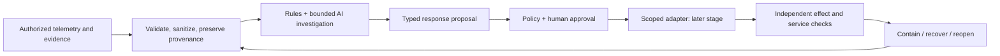

<p align="center">
  <a href="https://lumoslab-innovation.github.io/OpenShieldAI/"></a>
</p>

<h1 align="center">OpenShieldAI</h1>
<p align="center"><strong>Evidence-grounded AI defense, incident response and recovery.</strong></p>
<p align="center">Prepare · Investigate · Respond · Verify recovery</p>

<p align="center">
  <a href="https://lumoslab-innovation.github.io/OpenShieldAI/">Vision &amp; architecture</a> ·
  <a href="docs/research/AI_DEFENSE_EVIDENCE.md">Research</a> ·
  <a href="docs/ROADMAP.md">Roadmap</a> ·
  <a href="CONTRIBUTING.md">Contribute</a>
</p>

<p align="center">
  <a href="docs/ROADMAP.md"></a>
  <a href="LICENSE"></a>
  <a href="docs/SECURITY_GUARDRAILS.md"></a>
  <a href="https://github.com/LumosLab-Innovation/OpenShieldAI/actions/workflows/docs.yml"></a>
</p>

<p align="center">
  <a href="https://github.com/LumosLab-Innovation/OpenShieldAI/stargazers"></a>
  <a href="https://github.com/LumosLab-Innovation/OpenShieldAI/forks"></a>
  <a href="https://github.com/LumosLab-Innovation/OpenShieldAI/graphs/contributors"></a>
</p>

> **Current status — S0: research and specification.** This repository contains the product foundation, source-backed research and engineering rules. It has no deployable runtime, supported live integrations or measured protection capability yet. Diagrams, playbooks and adapters describe proposed behavior. There is no install command that starts a working defense product.

## The four engineering questions

| Question | Required mechanism and proof |
|---|---|
| Can it prevent an attack? | A deployed control on the attack path, no bypass, independently verified absence of the forbidden application effect and measured legitimate-traffic impact |
| Can it respond while harm is occurring? | Relevant observations and an available actuator; measure source-to-verified-effect time including AI, human approval and the damage window |
| Can it handle the aftermath? | Rebuild trust, address persistence/identity exposure and actually restore a usable isolated application with measured data loss and recovery time |
| Where is AI continuously present? | Resident event-driven investigation, posture/response/recovery planning and bounded observations over durable evidence state; explicit degraded mode on failure |

[Full question checklist](docs/CORE_QUESTIONS.md) · [Concrete operating architecture](docs/OPERATING_ARCHITECTURE.md) · [Adversarial architecture review](docs/research/ARCHITECTURE_CHALLENGE.md)

The selected design separates immediate execution of approved controls from AI supervision. The first lab pairs Caddy + Coraza/CRS ingress with a private origin, an independent effect observer and an isolated restic/application recovery drill. The first response actuator stops new ingress for an accepted low-impact site; it does not prove host, identity or egress containment. None of this runtime exists yet.

## Why OpenShieldAI

As AI makes more security work automatable, defenders need to turn uncertain evidence into safe, timely decisions. Our long-term goal is to help operators prepare for attacks, investigate compromise, contain damage and recover usable systems and data with verifiable results.

OpenShieldAI is designed as an **independent defensive system**. It starts from authorized operational telemetry, evidence and recovery capabilities. Collaboration with [OpenHunterAI](https://github.com/LumosLab-Innovation/OpenHunterAI) comes later, after standalone value is demonstrated.

The research question is practical: **can bounded AI reduce incident harm and operator effort beyond deterministic rules and existing tools, without creating a more dangerous control plane?**

## What the project aims to do

| Before an incident | During an incident | After containment |
|---|---|---|
| Identify observed control and visibility gaps | Build a source-linked timeline and competing hypotheses | Assess persistence and unresolved exposure |
| Check response ownership and service dependencies | Request specific missing evidence | Validate backups and isolated restore drills |
| Review recovery readiness | Propose narrow, approved containment | Verify application/data integrity and actual recovery time |
| Rehearse known failure scenarios | Check the effect and legitimate-service health | Improve reviewed playbooks and prevention controls |

Study areas include account takeover, web/host compromise, suspected data exfiltration, ransomware/data loss, service disruption and AI-agent/tool-chain compromise. These are research/playbook areas, **not a supported-feature list**.

## The defense loop



AI proposes and explains. Deterministic policy controls authority. A human approves mutations. An independent observer checks the outcome. Original forensic evidence and executor credentials stay outside model context.

## Build on existing tools

We researched **15 core upstream repositories**, with exact reviewed commits, license evidence and explicit adoption decisions in the [registry](docs/research/upstreams.json). Nothing is vendored, installed or automatically enabled.

| Role | Candidates / references | Proposed boundary |
|---|---|---|
| Policy | OPA | Evaluate only if native policy becomes insufficient; runner still enforces decisions |
| Event interoperability | OCSF, OpenTelemetry | Small event mappings; optional existing telemetry transport |
| Detection content | Sigma | Manually curated rules, correct field mapping and attribution |
| Web containment | Coraza + OWASP CRS **or** CrowdSec | Select one observed/tested enforcement route; never publish model-generated rules directly |
| Recovery | restic + rest-server | Existing backup metadata and isolated restore verification; no AI backup engine |
| Existing endpoint/runtime tools | Velociraptor, Falco, Wazuh | Read-only evidence adapters according to pilot needs |
| Case/SOAR architecture | Cortex, Shuffle, TheHive legacy | Reference/evaluate selectively; no full-platform fork |

Licenses differ by component and content. Sigma rules, Wazuh components and current versus legacy TheHive need particular care. Researching an API does not establish redistribution rights. See the [full evaluation](docs/research/UPSTREAM_EVALUATION.md).

## Research before claims

The [AI defense evidence review](docs/research/AI_DEFENSE_EVIDENCE.md) separates useful bounded results from open-ended defense limitations, benchmark ambiguity and recent preprints. The [skeptical review](docs/research/SKEPTICAL_REVIEW.md) rejects features without observable inputs, legitimate authority, a fair baseline, independent ground truth, measurable benefit and a safe failure path.

We do not claim that another project's paper scores belong to OpenShieldAI, that an AI summary confirms compromise, or that a backup listing proves recovery. No observed alert is not evidence of no breach.

## Delivery sequence

| Stage | Scope | Status |
|---|---|---|
| S0 | Research, architecture, strict rules and evaluation design | This repository |
| S1 | Offline replay, resident AI investigation, deterministic ablation and typed proposals | Planned |
| S2 | One read-only telemetry adapter and operator shadow pilot | Planned |
| S3 | One approved response adapter and isolated restore drill | Gated |
| S4 | Expand independently proven prevention, incident and AI-agent defense capabilities | Research roadmap |
| S5 | Optional sanitized Hunter report / manual retest exchange | Deferred until standalone gates |

See [roadmap](docs/ROADMAP.md), [acceptance criteria](docs/ACCEPTANCE_CRITERIA.md) and [production readiness](docs/PRODUCTION_READINESS.md). No production capability is approved by these documents.

## Non-negotiable controls

- Explicit asset enrollment and defensive authority; a report never grants access.
- Untrusted telemetry, documents and model output cannot change policy or invoke arbitrary tools.
- No free-form privileged shell, hack-back, autonomous destructive response or production restore.
- Action-bound approval, least privilege, deadlines, cancellation, audit and state reconciliation.
- Separate execution receipts from independently verified containment and recovery.
- Preserve original evidence; sanitize derived facts before models and exports.
- Missing telemetry, failed tools and uncertain outcomes stay visible.
- No guaranteed decryption, recovery without usable backups/keys, or reversal of data disclosure.

The complete rules are in [AGENTS.md](AGENTS.md) and [security guardrails](docs/SECURITY_GUARDRAILS.md).

## Explore or contribute

Start with the [documentation map](docs/README.md). Product and engineering decisions live in versioned documents and [ADRs](docs/adr/0001-evidence-first-defense.md); research sources are refreshed only through [manual reviewed enrichment](docs/MANUAL_UPSTREAM_ENRICHMENT_POLICY.md).

For the documentation-only foundation, Python 3.11+ runs the local checks with no third-party packages:

```text
python scripts/check_docs.py
python -m unittest discover -s scripts -p "test_*.py"
```

These checks validate documentation links and research-registry invariants. They do not test incident detection, response, restore or AI efficacy. Follow [contributing guidance](CONTRIBUTING.md); use GitHub Issues for sanitized proposals and reproducible defects.

## Community

Help turn the research into defensive capabilities that earn operator trust. Useful contributions include reproducible replay scenarios, primary-source research, carefully scoped playbooks, evaluation design and documentation improvements. Start with the [contribution guide](CONTRIBUTING.md) and [open issues](https://github.com/LumosLab-Innovation/OpenShieldAI/issues); discuss scope before submitting a new integration.

- [Propose research or report a defect](https://github.com/LumosLab-Innovation/OpenShieldAI/issues/new/choose)
- [Review pull requests](https://github.com/LumosLab-Innovation/OpenShieldAI/pulls)
- [Explore contributors](https://github.com/LumosLab-Innovation/OpenShieldAI/graphs/contributors)
- [Star the project](https://github.com/LumosLab-Innovation/OpenShieldAI/stargazers) to follow its progress

### Contributors

<a href="https://github.com/LumosLab-Innovation/OpenShieldAI/graphs/contributors">
  
</a>

Contributor avatars are generated from this repository's GitHub contribution history by [contrib.rocks](https://contrib.rocks).

### Star history

The chart will populate as the project receives its first stars.

[](https://star-history.com/#LumosLab-Innovation/OpenShieldAI&Date)

## Security and license

Never put real incident evidence, credentials or exploitable private target details in public issues. Follow [SECURITY.md](SECURITY.md) for private vulnerability reporting.

Copyright © 2026 HungBil. OpenShieldAI is **source-available under PolyForm Noncommercial 1.0.0**, matching OpenHunterAI's licensing policy. It is not an OSI-approved open-source license. Commercial use requires a separate written license from HungBil. Upstream components retain their own terms. See [LICENSE](LICENSE) and [LICENSING.md](LICENSING.md).
