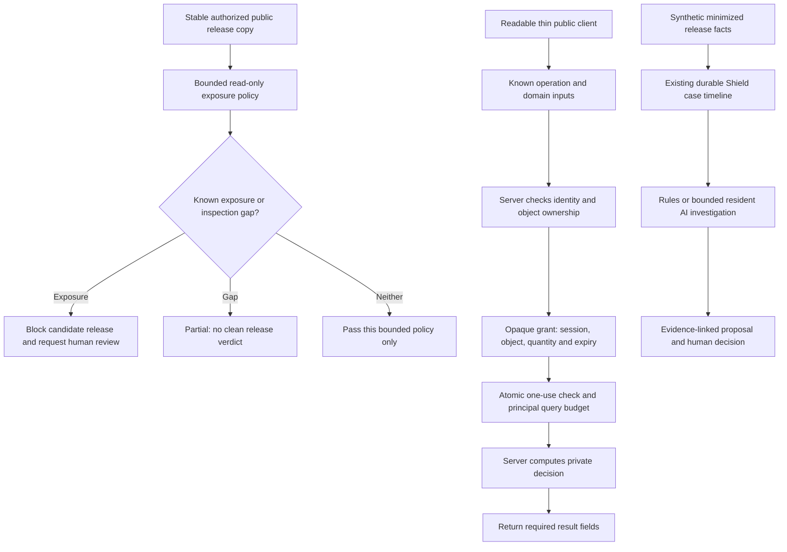

# REA-informed release and server-authority defense

This experimental slice addresses two concrete failures: accidentally delivering private implementation material to a browser, and allowing a reconstructed client to invoke operations without server authority. It does not make public JavaScript unreconstructable, identify REA users, prevent all copying, or prove production protection. The [source review](research/REA_DEFENSE_RESEARCH.md) studies actual REA release `27dc42d10249f0410904a75c0997842eb03b931c` / `rea-agents@6.7.0` and a separately pinned current source snapshot. See [measured results](lab/ANTI_REA_RESULTS.md) for executed checks and remaining gaps.

## Implemented path



The implementation uses Python's standard library and the existing runtime boundaries. It adds no network collector, obfuscator, remote executor, browser fingerprinting or provider SDK.

The [parallel defense increment](PARALLEL_DEFENSE.md) now checks explicitly authorized loopback delivery and durable quote authority as separate boundaries. Its [current results](lab/PARALLEL_DEFENSE_RESULTS.md) supplement the historical REA/Chrome run; they do not replace that run's artifact fingerprints or silently extend its coverage.

| Module | Current responsibility |
|---|---|
| [exposure.py](../openshield/exposure.py) | `exposure_audit`: inspect an explicitly authorized local release copy; emit opaque IDs/digests, counts, policy categories and gaps |
| [delivery.py](../openshield/delivery.py) | Compare declared loopback HTTP identity/gzip representations with a reviewed local reference; check source-map headers and declared retired paths |
| [authority.py](../openshield/authority.py) | Hash-only quote grants/sessions, durable principal spend and revocation in bounded local SQLite transactions |
| [cli.py](../openshield/cli.py) | `release-audit` and `anti-rea-lab`; release-audit reports cannot be written inside their audited release |
| [anti_rea.py](../lab/anti_rea.py) | Owned synthetic loopback HTTP application, before/after public exports, operation grants and adversarial trials |
| [core.py](../openshield/core.py) | Typed synthetic `release_exposure` facts join the existing durable timeline and control-gap investigation |

## Audit a release copy

From the repository root, with Python 3.11+:

```powershell
python -m openshield release-audit .\release-copy --authorized
python -m openshield release-audit .\release-copy --authorized --output .\output\release-audit.json
```

Use a stable, owner-authorized web release directory. The audit reads files without running JavaScript, following evidence URLs, calling REA or invoking a model. `--output` writes the bounded report outside that release using atomic replacement, preserving source bytes even if an existing output is a hardlink; omit it for stdout. A complete policy pass exits `0`; a blocked or partial result exits `1`. Invalid input/configuration also fails without echoing sensitive error text.

The policy detects selected source-map files and references, embedded original-content indicators, development/source/backup/database artifacts, environment-file names and selected private-key material. Orphan maps are inspected even without a bundle reference. JavaScript/CSS comments and HTML/XML/SVG inline code receive bounded lexical checks; ambiguous or uninspected code carriers remain gaps. Container extensions and recognized container signatures are refused for a clean verdict, including renamed supported signatures. The audit does not unpack archives or execute code to resolve expressions.

Limits include 2,048 files, 4,096 entries, depth 16, 8 MiB per file, 64 MiB total input, a cooperative 10-second deadline and bounded observation detail. Links, aliases, unsafe file types, concurrent changes and exceeded limits cannot produce a complete pass. The selected image/font handling checks headers only; it does not inspect arbitrary embedded payloads. A candidate code-data URI may produce a conservative gap even when it is merely a documentation string.

**`pass` means no matched rule and no recorded gap under this policy.** It does not prove absence of unknown secrets, private formulas, PII, encoded concepts or reconstructable behavior. This release-directory check does not inspect deployed HTTP headers, CDN/object-storage permissions, old releases or previously downloaded/service-worker-cached assets. Digests bind observed bytes; they do not independently authenticate their origin. A REA timeout, missing runtime or partial parse is never a defensive success.

## Verify declared HTTP delivery

```powershell
python -m openshield delivery-audit .\release-copy --base-url http://127.0.0.1:PORT --authorized --retired-path /retired/app.js.map
python -m openshield delivery-lab
```

This second audit first requires a complete local policy pass, records that reference commitment, and GETs each declared asset with identity and gzip requests. When `index.html` is in the reference it also checks `/`. It decodes bounded supported content codings and compares the resulting bytes with the reviewed file digest. Unexpected bytes or `SourceMap`/legacy `X-SourceMap` response headers block the candidate. Each explicitly declared retired path must return `404` or `410` for both requested representations; an application-page fallback is a policy violation, not proof its body contains private source.

The header check follows [ECMA-426 source-map linking](https://tc39.es/ecma426/#sec-linking-through-http-headers); deleting a JavaScript annotation alone does not remove this separate discovery channel. Representation checks use the distinction between encoded content and decoded representation described by [RFC 9110 §8.4](https://www.rfc-editor.org/rfc/rfc9110.html#section-8.4). These standards motivate the checks; the stricter release policy is this project's decision.

Only an explicit `http://127.0.0.1:PORT` static preview is accepted. There is no credential, DNS resolution, redirect following, JavaScript execution or source-map URL fetch. The bounded defaults are 256 files, 512 entries, depth 16, 2 MiB per response/file, 16 MiB aggregate wire and decoded bytes, 16 retired paths, two seconds per HTTP operation and a ten-second total job deadline. Unsupported coding, malformed/truncated/concatenated gzip, excess bytes, redirects, reference changes and timeouts remain gaps rather than a clean verdict.

This audit makes real HTTP GET requests and requires operator authorization; GET is expected to be safe on the selected static preview but a misconfigured handler can have effects. Reports contain opaque path IDs, digests, counts and fixed codes. Coverage is **declared reference and retired paths only**, at the observed preview and time. Unknown routes, external origins, CDN variants, browser/service-worker caches, historical downloads and an operator-supplied reference's authenticity remain outside it. The gate stops promotion only when the operator wires its result into their release process; it does not intercept live serving or recall disclosed bytes.

## Run the actual HTTP experiment

```powershell
python -m openshield anti-rea-lab --output .\output\anti-rea-results.json
python -m unittest tests.test_exposure tests.test_anti_rea tests.test_anti_rea_adversarial -v
```

The trial starts temporary loopback HTTP servers with synthetic identities/data and closes them afterward. It does not connect to a customer application or invoke REA/AI. Separate pinned-REA observations, if performed, remain separately identified in the results.

The before release ships a planted private-rule marker, an unnecessary pricing implementation and a source map containing original text. Its server also accepts a direct unauthenticated quote request. The after release removes that implementation/map from the public exports and leaves a readable thin client that calls the same known server API. One `_exports` function supplies both the audited static files and served responses; integration tests compare their actual bytes. Source-map/private/unlisted paths return errors rather than a catch-all application page.

The protected server validates the exact object/quantity schema, an opaque controller-issued session and object ownership. It issues an opaque grant for the quote operation, bound to the exact session, object, quantity and server-clock expiry. The default lifetime is 30 seconds. In the current increment, grant consumption and the principal's accepted-query count share one SQLite `BEGIN IMMEDIATE` transaction: replay and concurrent reuse cannot authorize another operation. A new session, grant, process or reopening of the same configured state does not reset the same principal's quota of four accepted quotes. Public knowledge of `/api/quote` grants no authority.

This quota is an intentionally small experiment allowance, not a recommended production threshold. Session/grant values are stored as SHA-256 digests; the controller retains the raw opaque values only for use in the lab. Reopening the same database preserves consumed grants, principal spend and session revocation. Concurrent connections/processes share the write boundary; SQLite documents its [transaction and writer semantics](https://sqlite.org/lang_transaction.html). A failed authority database, backward persisted clock or incompatible configuration fails closed instead of becoming an empty in-memory allowance. Tests also exercise revoked sessions and outstanding grants after restart.

The default experiment uses a temporary database which is removed after its run; persistence is measured by explicitly reopening the same state path. Creating a new absent state path intentionally starts a new lab. An attacker who can restore an older valid database can roll back the spend and clock watermark together: there is no external anti-rollback anchor. Local host/storage access is trusted; digest storage is not encryption, host-compromise resistance or accepted production authentication. This fixed pure calculation does not implement reconciliation for external side effects or ambiguous delivery. A stolen authorized session, same-origin script compromise, additional authorized principals, distributed deployment and production availability remain outside the proof.

**Removing shipped code and preventing inference are different claims.** The trial deliberately shows that a few allowed quote results reveal its simple linear formula even after the formula disappears from delivered files. The formula is also public in this repository because it is synthetic. The experiment measures delivered-byte reduction, server authority and bounded sampling; it cannot establish secrecy of an arbitrary business algorithm.

## Continuous AI and typed evidence

The existing runtime accepts this additional fact shape only within `lab_event_v1`:

```json
{
  "kind": "release_exposure",
  "facts": {
    "status": "blocked",
    "observationCount": 2,
    "gapCount": 0
  }
}
```

This is a fragment, not a complete ingestion envelope. The full record still requires the existing opaque IDs, enrolled project/asset/source, UTC timestamp, `schemaVersion: "lab_event_v1"` and `dataClass: "synthetic"`. Status is exactly `pass`, `blocked` or `partial`; counts are bounded nonnegative integers. Raw source, endpoint strings, maps, paths, arbitrary observations and unknown fields are not admitted as additional facts.

A blocked/partial result or nonzero observation/gap count contributes `control_gap` and human review under the deterministic baseline. That evidence alone does not establish an attack; assessment remains insufficient evidence. Existing resident supervision can review changed accepted facts through the bounded LLM Gateway, retain evidence-linked hypotheses/proposals and expose provider degradation. There is no automatic production release collector, automatic report-to-model ingestion or new containment action here.

**Do not relabel a production audit report as synthetic to feed this runtime.** The standalone read-only auditor and the synthetic incident timeline have different admission boundaries. A real-source adapter would require its own source authentication, minimization, retention, enrollment and acceptance work. No API endpoint is configured for the measured AI arm, so actual AI benefit remains unmeasured; an AI-disabled or unavailable arm is not a zero-error AI result. See [runtime and provider instructions](RUNTIME.md).

## Manual response after confirmed exposure

1. Preserve the reviewed release identity, delivery paths and original evidence in the operator's restricted evidence system. Keep ordinary reports minimized; do not publish the exposed contents again.
2. Stop promotion of the affected candidate through the existing release process. Identify whether the issue is disclosed implementation, exposed credentials, unintended data or an actual server-authority defect; each needs a different fix.
3. Remove unintended public artifacts and fix backend authorization, object scope and output minimization. Test direct requests using known URLs; hiding a button or renaming an endpoint is insufficient.
4. Review owned origin/CDN/old-hash paths, map headers and service-worker behavior. Purge or invalidate unintended published copies through an approved operator process, preserving forensic originals. Existing third-party downloads cannot be recalled.
5. If real credentials were exposed, use the approved secret-management incident procedure to revoke/rotate them, assess access and prevent operator lockout. Revocation is not reversible and must not be automated from this policy result or a model's suspicion.
6. Re-audit the candidate and verify actual served responses, legitimate user behavior and denial of unauthorized requests. Record unresolved historical exposure and possible misuse. Deleting a map cannot undo prior disclosure or exfiltration.

The practical goal is less unnecessary delivery, strong server authority and observable gaps. No “REA-proof” or general anti-copying claim follows from a successful lab.
