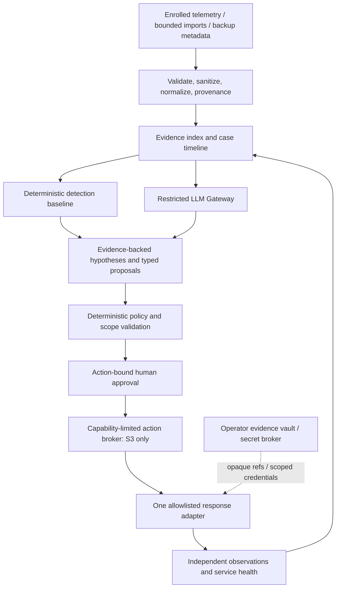

# Architecture

Status: proposed; no components below are executable in this repository yet.

## Selected design

Start with one local Python application organized by domain modules, a CLI-first replay path, SQLite for sanitized case metadata, and operator-controlled evidence storage. The later authenticated API/UI uses the same application services. Do not add a message broker, microservices, multiple databases or an agent framework until measured workload or isolation requirements justify it. SQLite is for a single-operator pilot, not an enterprise scaling claim.

In S1/S2 the broker is disabled; operator-managed receipts and evidence enter the verification path. The LLM has no route to the broker, vault, shell, policy files or approval keys.

## Domains and interfaces

| Module | Responsibility | Must not do |
|---|---|---|
| Enrollment | Assets, service dependencies, data class, operator roles and scope version | Infer authority from a hostname or alert |
| Ingestion | Bounded parsers, signed/identified source envelopes, clock and coverage checks | Execute files, follow evidence URLs, trust alert instructions |
| Evidence | Stable references, derivation lineage, integrity and access journal | Rewrite originals or treat a hash as authenticity |
| Detection | Explicit rule results, negative controls and coverage gaps | Claim ATT&CK coverage because a rule is installed |
| Investigation | Timeline, competing hypotheses, evidence requests, contradiction review | Turn speculation into confirmed compromise |
| Planning | Catalog playbook instances and typed action proposals | Invent shell commands or install tools |
| Policy / approval | Deny by default, action hashes, expiry, state freshness and separation of duties | Delegate authorization to a model |
| Execution | Adapter-specific scoped operation and reconciled receipt | Interpret free-form text or retry unknown outcomes |
| Verification | Separate observations, availability/integrity checks and residual risk | Accept executor self-report as proof |
| Recovery | Backup readiness, isolated restore drill and application checks | Overwrite production or promise decryption without keys |
| Audit | Append-only logical record, hash chaining, off-host checkpoint/export | Claim protection from a fully compromised host without external trust |

Contracts are defined in [DATA_CONTRACTS.md](DATA_CONTRACTS.md); implementation must encode and test schemas before accepting network inputs.

## Deployment and trust boundaries

S1 is offline replay with synthetic/sanitized local files. S2 is a single-organization pilot with explicit authentication, asset authorization and an encrypted local volume. CLI access follows host identity/OS permissions. A later network API binds to loopback by default; remote access needs authenticated TLS and a separately approved deployment configuration. No public unauthenticated incident API.

1. **Telemetry → ingestion:** even an authenticated agent can be compromised. Preserve source trust, freshness, clock skew, duplication and contradictions; do not treat signatures as factual correctness.
2. **Evidence → model:** only bounded sanitized derived facts under the permitted data policy. Content is data, never instructions. Retrieval sources cannot change policy or executable catalogs.
3. **Model → control plane:** reject unknown IDs, unknown action types and free-form executable content. Validate against frozen enrollment, policy and current state.
4. **Approval → executor:** short-lived, single-use authorization bound to immutable proposal and expected state. Reauthorize on drift or expanded impact. Network allowlists alone do not establish asset ownership.
5. **Executor → target:** scoped credentials, exact registered endpoint, mTLS/service authentication where supported, egress control, no redirect or DNS rebinding bypass. Private enrolled endpoints are permitted; arbitrary private address discovery and metadata-service access are forbidden.
6. **Control plane → evidence/backup systems:** use separate read and execution identities; never mount source evidence writable or reuse backup administrator credentials for response.

## Failure and concurrency behavior

Use a durable state machine and transaction/outbox in the single application rather than a broker initially. Persist proposal/approval/attempt intent before dispatch. Leases, run IDs and idempotency prevent duplicated work. A crash after dispatch produces `unknown_outcome`; reconcile with the target before another mutation. A late callback cannot resurrect expired authority.

Policy/approval/audit failure blocks new mutations. Model failure falls back to deterministic triage with an explicit limitation. Source failure produces a visibility gap. Kill switch revokes pending execution capabilities and stops dispatch; record in-flight operations and require explicit reconciliation. Budget exhaustion must preserve case/evidence and produce an incomplete result.

## Recovery architecture

Use an existing backup product through a narrow read-only metadata adapter first. A recovery drill uses a separate identity, isolated scratch target, pinned snapshot ID, no production overwrite and clean-network constraints. Hash/file verification is necessary but insufficient: check database consistency, application invariants, service health, contamination and measured RPO/RTO. Restoring bytes does not undo disclosure or prove persistence removal.

## AI application defense

Protect both the operator's AI systems and Shield itself. Proposed telemetry includes agent identity, requested capability, decision, action ID and provenance of tool results; prompts and secrets are excluded. An untrusted tool result may trigger an investigation but cannot grant permission. Capability revocation is a typed approved operation, not an agent-to-agent instruction. The replay suite must include tool-output poisoning, forged approvals, malicious retrieved documents and cross-case evidence references.

## Interoperability and scaling

Read-only, versioned adapters translate existing tools into native evidence envelopes; tools remain separately installed and licensed. Evaluate normalized taxonomies such as OCSF only when they solve real adapter mapping needs; do not import a large ontology into the MVP. [Research decisions](research/UPSTREAM_EVALUATION.md) track candidates.

OpenHunterAI collaboration is a later adapter, not the central bus or source of authority. See [contract proposal](OPENHUNTER_COLLABORATION.md). Enterprise tenancy, distributed queues, high availability and large-volume retention require new ADRs and isolation/load tests after the pilot.
