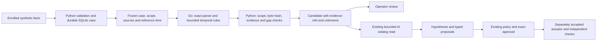

# Bounded Go analysis runtime

Status: an implemented **S1 synthetic, read-only worker**, not a live collector or a production security service. The [PM portfolio](research/SECURITY_PORTFOLIO.md) covers 24 proposed scenarios; the [BA method register](research/DEFENSE_METHODS_AND_HYPOTHESES.md) defines 13 methods and 16 falsifiable hypotheses. That breadth guides experiments; it does not turn one correlator into support for all incident families. [ADR 0003](adr/0003-bounded-go-analysis-workers.md) and the [independent review](research/GO_RUST_EFFICACY_REVIEW.md) explain the language and scope decisions.

## Placement and authority



Go handles one bounded local analysis request. Python/SQLite retains enrollment, temporal evidence, resident scheduling, the CLIProxyAPI gateway, policy, exact approvals and audit. The worker has no action catalog, credential, target URL, network client or target-file reader. A candidate grants no authority. Python accepts output only if it matches the frozen input scope/hash and has supported in-window references, counts, limitations and visibility gaps.

Go was chosen for this small independently built component, using only its standard library. The existing Caddy/Coraza Go dependency graph is not imported into the worker. Rust remains an option for a concrete parser/sensor or measured workload that justifies another toolchain, ownership and fuzzing effort. Rust tooling was unavailable on this host's PATH. No whole-repository migration or performance superiority over Python/Rust has been established.

## Build and run

Use an explicitly installed Go toolchain. The module minimum and locally measured toolchain are **Go 1.26.4**; CI selects the separately verified **Go 1.27.3** release. Toolchain patch maintenance and vulnerability review remain deployment responsibilities. No runtime command downloads or compiles a tool automatically.

Windows PowerShell, from the repository root:

```powershell
$env:GOTOOLCHAIN='local'
$env:GOPROXY='off'
$env:GOSUMDB='off'
go -C runtime-go test ./...
go -C runtime-go vet ./...
go -C runtime-go build -trimpath -o ../artifacts/runtime-go/shield-correlate.exe ./cmd/shield-correlate
python -m scripts.check_go_runtime --output output/go-correlation-results.json
python -m unittest discover -s tests -p 'test_*.py' -v
```

On Linux/macOS, build the same fixed output path without `.exe`. Go has no external module dependencies here; `GOPROXY=off` prevents an implicit module fetch. The binary is operator-owned trusted software; a path and byte digest are not a verified software-supply-chain attestation. Build/test the source before using it and keep that directory outside untrusted evidence write access.

For a case already accepted by the synthetic runtime:

```text
python -m openshield --state incident-data/demo.sqlite3 correlate CASE_ID --project lab --output output/access-patterns.json
```

The case must already have the appropriate enrollment and opaque `auth_decision` / `source_health` facts. `correlate` uses the store's reference clock, does not rewrite the case, and does not enable an action. Report destinations cannot replace runtime/action databases or their SQLite sidecars. Missing worker, failed process, timeout or invalid reply fails visibly. Fresh live-time CLI analysis of an old replay correctly reports an empty/stale window; the registered corpus script supplies its fixed reference time directly.

## Exact rule semantics

Both rules operate on generic **object authorization decisions**, not login/password telemetry. For one enrolled project/case/asset and each `(subjectLabel, objectLabel)`:

| Rule | Condition in `(asOf − 60 seconds, asOf]` | Defensible interpretation |
|---|---|---|
| `repeated_access_denials` | At least five unique deny events | Repeated denied object access worth investigating |
| `denied_access_then_allow` | An allow with at least three strictly earlier deny events | A change in observed access outcome worth explaining |

The thresholds and window are fixed experimental settings, not calibrated incident probabilities or production recommendations. The algorithm sorts parsed UTC event time, then ID for deterministic presentation. ID order does not establish causality: equal-time mixed decisions yield `same_timestamp_order_unknown` and cannot form a strict sequence. Nanosecond precision is preserved in both Go and Python validation. This remains source-reported time, not proof of real-world causal order.

Exact duplicate IDs with equal content do not inflate counts. A repeated ID with changed content, mixed scope, undeclared source, invalid enum or credential-shaped label rejects the job. Old records are counted and excluded; future records are excluded with a gap. Source outage/loss remains a gap even if a later record reports healthy. Expected sources missing from the registered window remain explicit. Upstream stale/skew/visibility/observer gaps survive the worker and reply validator.

**An authorized policy change or retry may produce the same observations as harmful access.** Low-and-slow abuse, distributed campaigns, missing decisions, source deception and activity outside the selected window can evade these rules. The result always has `isFinding: false` and `coverage.complete: false`; successful processing is not a clean bill of security. [Measured counterexamples](lab/GO_CORRELATION_RESULTS.md) are retained.

## Worker and caller contract

The fixed executable reads one `correlation_request_v1` JSON document from stdin and emits one `correlation_result_v1` JSON document. The request carries `runId`, project/case/asset IDs, immutable enrollment `scopeVersion`, UTC `asOf`, declared `sourceIds`, known `upstreamGaps` and only the two supported existing `lab_event_v1` event kinds. Extra timeline decorations are removed by the caller; truth labels never enter this request.

| Boundary | Implemented limit / behavior |
|---|---|
| Input | 1 MiB, 1,000 events, 16 declared sources, depth 16 and 60,000 parsed value nodes |
| JSON | Reject duplicate names, field-case aliases, unknown/missing/null fields, invalid UTF-8, trailing documents and invalid field types |
| Scope | Exact project/case/asset/source matching; opaque bounded IDs; immutable scope hash binding |
| Analysis | Serial batch; cooperative 500 ms after input read, checked through parsing and completion |
| Output | At most 64 candidates, 20 references each and 64 KiB serialized output; truncation makes the result partial with a gap |
| Parent | Fixed executable/argv, no shell, stripped environment, bounded pipe reader, direct-child termination after two seconds from spawn |
| Memory | 64 MiB soft Go GC target plus bounded input/cardinality; **no hard OS memory sandbox claim** |
| Failure | One sanitized failed record from Go; caller rejects invalid output and exposes a safe error |

Directly invoking the raw binary with stdin left open can still wait for input: the Python supervisor's deadline is part of the supported boundary. The executable spawns no descendants. The wrapper is not a general hostile-program sandbox. CLI users can launch multiple processes; this does not provide fleet admission control, a persistent queue, authenticated collectors, global backpressure or enterprise tenancy. The existing resident supervisor remains serial with its prior episode/concurrency ceilings.

The result identifies rule version, run/scope, exact request-byte SHA-256, window, duplicate/old/future counts, observed sources, gaps and candidate evidence. Hashes bind inspected bytes; enrolled source names are still operator assertions rather than cryptographic source authentication. Unknown/free-form fields are rejected before a report can enter model context.

## Resident AI integration

`access_patterns` is an additional bounded read catalog within the existing episode. It analyzes the **original frozen case snapshot**, not an expanded/new case received while a model is running. The selected limit caps returned candidates and reports omitted candidates. Existing two-read-round/three-reads-per-round limits and the originating episode's deadline/budget still apply; reading this result cannot reset model reservations or expand action scope.

The model receives validated candidate enums, opaque labels/references, counts/coverage and stated limitations. It can ask for missing evidence or propose a hypothesis; it cannot turn the candidate into a verified finding, change thresholds, choose an executable or issue a revocation. A missing/failed worker produces `degraded_tool`, `incomplete_evidence` and `degraded_observation` health, with deterministic fallback rather than a fake successful read. Contract tests use a labelled gateway double. The real CLIProxyAPI endpoint remains unconfigured and **incremental AI value remains unmeasured**.

## Performance and next experiments

See [reproducible local results](lab/GO_CORRELATION_RESULTS.md) for full-workload timing, allocations, raw samples and business-interpretation failures. The current evidence demonstrates a bounded working Go component. It does not establish reduced attack harm, language speedup or production throughput.

The next PM experiments need new observations and independent effect oracles: an AI-tool capability deny test, real session-revocation semantics, telemetry-loss/overload behavior and accepted recovery cases. Each needs its own owner, control point, hypothesis, baseline, negative controls and authority gates. A new detector or an additional language does not satisfy those gates by itself.
