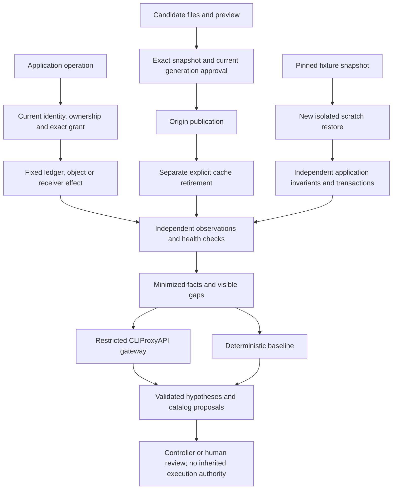

# Next-wave application, publication and recovery methods

Status: **S1 owned synthetic experiments**. This increment implements further bounded slices of the [24-case PM portfolio](research/SECURITY_PORTFOLIO.md) and [BA methods](research/DEFENSE_METHODS_AND_HYPOTHESES.md). It does not complete that portfolio or approve a production identity, egress, deployment or recovery adapter. [Measured results](lab/NEXT_WAVE_RESULTS.md) and [aggregate evidence](lab/evidence/next-wave.json) identify the actual run and separate model decisions from control effects.

## Mechanisms and real effects

| Component | Method | Observable success and required counterexample |
|---|---|---|
| [Go application flow](lab/FLOW_LAB_RESULTS.md) | Principal-wide login/read bounds; current session authority at both resource paths and immediately before effect; object ownership; exact one-use grants and atomic idempotency; fixed-recipient outbound broker refusing redirects | An unsafe fixture discloses another object's value, duplicates a charge, continues cached-session access or delivers to a forbidden receiver. Protected requests prevent the selected effect while legitimate own-object reads, approved charges and allowed receiver delivery still work |
| [Exact publication and retirement](lab/PROMOTION_RESULTS.md) | Local and HTTP candidate audits; immutable approved bytes; active-digest/generation precondition; separate exact retirement approval; explicit cache purge and epoch | Changing origin leaves four cached private representations available. Retirement stops new private-canary delivery through the declared origin/edge paths while all six required GET representations remain useful. Previously downloaded private bytes remain disclosed |
| [SQLite recovery readiness](lab/RECOVERY_READINESS_RESULTS.md) | Pin snapshot bytes; restore into a new scratch directory; independently check required objects, SQLite/FK integrity, per-account ledger equation and known trust marker; rollback and committed application transactions | Availability-only and hash-only comparators accept selected unusable applications. Full probes reject them and preserve the clean application's useful transfer, without modifying source or pinned snapshot |
| [Existing gateway and comparison](RUNTIME.md#cliproxyapi--codex-adapter) | Bounded sanitized facts, fixed model alias from operator config, absolute deadline, schema/evidence validation, visible degradation and shared reservation ceiling | Real permitted inference is counted only when validated. Unconfigured, failed, fallback or budget-blocked inference earns no successful-AI decision; the same deterministic controls continue |

These experiments use real loopback HTTP, actual ledger/inbox/cache effects and actual SQLite copies. Synthetic means the identities, objects and harm are deliberately owned fixtures; it does not mean that a fabricated executor receipt establishes success.



The model is outside the application's enforcement path. Neither a model outage nor a better model answer changes who can read an object, charge a ledger, choose a receiver, approve a release or overwrite a restore destination.

## Coverage ledger: all 24 cases

The labels describe evidence for a **slice**, never complete support for the whole incident family. **Prior slice** means code/effect evidence existed before this increment. **New slice** means a selected method now has an owned effect experiment. **Existing limited proof** means a related mechanism is exercised but important requirements of the portfolio case remain absent. **Unsupported** means no accepted real adapter or case-specific effect experiment is supplied here; a generic rule or relevant paper is insufficient.

| PM case | Slice status | Actual evidence | Missing source/authority before broader support |
|---|---|---|---|
| **I1 Credential abuse** | New slice | Fixed synthetic authenticator result; three-failure per-principal throttle, window expiry and a different principal's successful login | Accepted authentication/IdP source, password/MFA semantics, representative benign/attack workload and operator-accepted lockout envelope |
| **I2 Stolen session** | New slice; prior quote revocation | Two application verifiers reject revoked sessions; a paused request is rechecked before effect; valid unrelated session remains useful | Real IdP/resource servers, refresh/JWT propagation, all descendant grants, accepted revocation identity and response procedure |
| **I3 Privilege escalation** | Unsupported | No role-change/help-desk effect fixture or accepted source | Business role model, authenticated reset/role/change audit, exact approved authority and independent privilege checks |
| **I4 Service credential exposure** | Unsupported | No credential rotation/revocation adapter; no raw credential collection | Owner-approved secret/workload identity evidence, dependent-consumer inventory, qualified-human replacement/lockout procedure and enrolled verifier |
| **W1 Request attack/bypass** | Existing limited proof | [Prior Caddy/Coraza lab](lab/RESULTS.md) blocked three planted request effects; direct-origin and legitimate-path checks have declared limits | Accepted deployed proxy/origin configuration, complete relevant paths/protocols, source minimization and representative exploit/benign replay |
| **W2 Release exposure/REA** | New slice extending prior release/authority checks | Actual stale script/map identity/gzip delivery persists after promotion; explicit owned-edge purge and map retirement stop new delivery on fixed paths | Accepted publication/CDN/browser closure, producer provenance and actual cache controls; historical downloads and authorized-output inference remain unresolved |
| **W3 BOLA/business-flow abuse** | New slice; prior quote binding | Wrong-object values blocked at both paths; principal read quota; approved ledger/idempotency commit once under concurrency; useful own-object work retained | Production ownership/field/delegation model, durable transaction storage, external side-effect reconciliation and accepted business impact policy |
| **W4 SSRF/outbound pivot** | New fixed-destination slice | Actual allowed receiver gets approved body; forbidden recipient and 307 redirect give zero requests at forbidden receiver | Accepted outbound boundary and destination ownership, DNS/address drift, protocol/alternate-process coverage; no general URL fetcher or metadata-service test |
| **H1 Unexpected process/file** | Unsupported | No accepted host collector or containment effect | Authenticated minimized ancestry/file source, deployment ledger, OS/EDR control owner and safe host isolation/rebuild authority |
| **H2 Living off the land** | Unsupported | No command execution or host effect fixture | Workload/parent lineage, approved maintenance evidence, relevant OS permissions/control and independent service observation |
| **H3 Source forgery/loss** | Existing limited synthetic proof | [Go correlation](GO_RUNTIME.md) and Python intake reject malformed/cross-scope input and expose replay/loss/freshness gaps | Authenticated real transport, enrollment/key/reset lifecycle, independently measured collection loss and compromised-source corroboration |
| **D1 Bulk destructive change** | Unsupported | Recovery fixtures plant loss; they do not demonstrate a running bulk-write containment control | Actual per-principal write/change source, approved-job context, relevant enrolled write actuator and measured continuing damage window |
| **D2 Backup unusable** | New readiness slice; prior restic negatives | No source and digest drift deny restore; required-object failures rejected; prior isolated restic drill separately tested missing/wrong key and corrupt pack | Accepted backup identity/custody/retention/key system, full verification coverage, interruption/failure reconciliation and owner recovery procedure |
| **D3 Contaminated/inconsistent restore** | New application-readiness slice | Hash-valid, balanced but ledger-inconsistent restore fails; FK/marker checks fail selected negatives; clean restore performs rollback and committed transfer | Trusted historical clean-point evidence, actual workload dependencies, contamination/persistence checks, qualified-human reconnection and production RPO/RTO acceptance |
| **D4 Exfiltration/extortion** | New fixed-egress slice | Unsafe fixture delivers two synthetic bodies outside; protected forbidden receiver sees zero requests; approved inbox receives one | Classified data/access and egress source, all real exit paths, identity/egress action authority and historical exposure investigation; no general DLP/extortion handling |
| **C1 Public data policy drift** | Unsupported | No enrolled cloud/object-store policy adapter or effective-access probe | Actual provider/inheritance semantics, approved policy/consumer model, enrolled synthetic-principal access probe and exact change authority |
| **C2 Artifact/build substitution** | New local publication slice | Changed approved tree rejected; only immutable approved bytes install even after a last-check path edit | Authenticated source/builder/attestation verification, accepted release review identity and actual deployment adapter; digest alone is not authenticity |
| **C3 Unauthorized deployment/rollback** | New local publication slice | Expected active digest/generation, one-use expiry and conditional swap reject stale/competing approvals | Durable production deployment ledger, external-writer conflict checks, actor identity, accepted rollback/reconciliation and independent deployed service/control health |
| **A1 Prompt injection/tool escalation** | Prior slice | [Go tool guard](lab/TOOL_GUARD_RESULTS.md) blocks a scripted forbidden write at execution; approved reads/write remain useful | Accepted agent/tool identity and actual tools; adaptive poisoned-content/model evaluation. Scripted proposed requests do not measure injection probability |
| **A2 Confidential egress/confused deputy** | Prior slice | Exact recipient/tenant/data-class binding; independent inbox delivery and valid approved receipt | Real classification/source authority, recipient semantics and full outbound channels; arbitrary text/encoded leakage and authorized redistribution remain open |
| **A3 Cross-agent approval laundering** | Prior slice | Exact case/asset/scope/policy/evidence bindings, expiry/replay/direct-call tests and single concurrent consumer | Real separated approver/executor identities, signing/transport/host trust, dynamic policy propagation and accepted external-tool authority |
| **V1 Burst/expensive API** | New limited bounds slice | Four admitted HTTP handlers; fifth refused before effect; eight reads shared across new sessions; admitted legitimate work resumes | Representative workload/cost/latency measurements, fairness and accepted service envelope, sustained capacity and upstream volumetric control |
| **V2 Low-and-slow/cumulative spend** | Unsupported | Existing bounded jobs/global model reservations are resource guards, not a representative cumulative-abuse detector | Workload/cost owner, actual operation duration/cost source, seasonality baseline, distributed identity model and independent benign completion |
| **V3 Defense overload/outage** | Existing limited synthetic proof | Durable supervisor dedup/watermarks, explicit degraded model/tool modes, worker/input/output/time limits and absolute provider deadline | Sustained queue/drop/SLO envelope, actual control/source outages, crash/partition reconciliation, reserved management/audit capacity and off-host trust |

There are **11 new slices (including V1's limited bounds), three prior slices, three existing limited proofs and seven unsupported cases**. These counts are a work ledger, not a protection score. None of the 24 has gained general production acceptance through this increment.

## AI comparison: decision quality is separate from control effect

The [next-wave record](lab/NEXT_WAVE_RESULTS.md) publishes the completed actual CLIProxyAPI/Codex run, earlier degraded trials and the frozen route/corpus/source manifest. The final 16-case assessment score ties the baseline; proposal/code-presence checks do not establish operational benefit. OAuth, an installed proxy, successful HTTP transport or a schema-valid answer is insufficient evidence of better investigation. No credential, token, raw source or private incident input belongs in the committed record.

The older 48-case corpus is now public regression material. The new 16-case engineering corpus is also a declared engineering comparison, **not a fresh held-out efficacy estimate**. Keep each run separate and disclose reuse or prompt/rule changes. Do not combine selected engineering assertions into a representative attack sample.

Both model and deterministic arms receive the same bounded facts, registered replay clock, case scope, read/action catalog and allowed observations. Truth/group/description and private controller history stay out of model inputs. Only successful validated real inference counts toward AI outcomes; deterministic fallback remains visible as degradation. Observably identical traces with different hidden histories must retain uncertainty rather than inventing information.

Report decisive correct assessments, abstentions, errors, unavailable/degraded cases, latency and token/reservation totals separately. The current assessment evaluator does not establish that a proposed action is necessary, useful evidence was selected, operator time was saved, or prevention/containment/recovery improved. A known-action/schema gate prevents authority escape; it cannot certify the proposal's semantic usefulness.

The [strict independent challenge](research/NEXT_WAVE_CHALLENGE.md) records actual counterexamples and corrections, including a provider-header trickle that had exceeded the absolute deadline and a missing object-disclosure observation. The fixes preserve both negative effects and useful positive controls. Independent observation means actual ledger/receiver/cache/application evidence, not a second model agreeing with the first.

## Run the fixed owned experiments

Python 3.11+ and the existing Go toolchain are sufficient; no extra package is required. Build the fixed platform binary first. On Windows:

```powershell
go -C runtime-go build -trimpath -o ../artifacts/runtime-go/shield-flow-lab.exe ./cmd/shield-flow-lab
python -m openshield next-wave-lab --output output/next-wave.json
python -m openshield promotion-lab --output output/promotion.json
python -m openshield recovery-readiness-lab --output output/recovery-readiness.json
```

On other platforms, omit `.exe`. These commands accept no target service, provider URL in evidence or restore destination. The aggregate runner starts only the owned fixed experiments. Enable the separately configured and authorized operator route explicitly with `next-wave-lab --with-ai`; follow [gateway configuration](RUNTIME.md#cliproxyapi--codex-adapter), including its credential environment and spend ceiling. No direct provider SDK or copied Codex credential is used.

The serving/ledger effects retain their own controller approvals; `--with-ai` adds bounded investigation comparison, not model execution authority. Ordinary CI can run the deterministic experiments and labelled transport tests without OAuth or provider inference. Actual model results and Docker reruns require their separately recorded environments.
