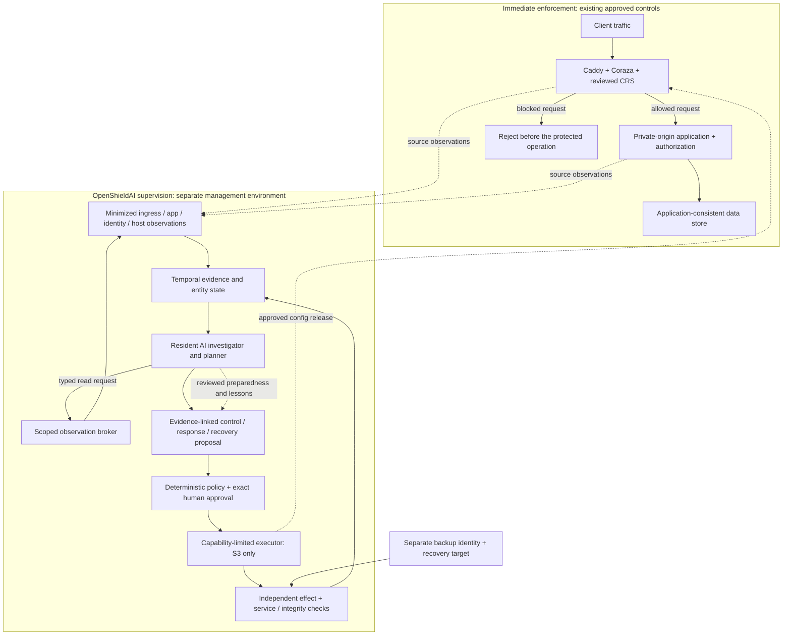

# Operating architecture: prevention, active response, recovery and continuous AI

Status: selected design for implementation, **not a deployed or benchmarked system**. This specification makes the four [core questions](CORE_QUESTIONS.md) concrete. Its lab choices do not authorize accessing a real environment or broaden S1/S2 execution rights.

## 1. The missing distinction: enforcement and supervision

Protection must have a control point on the attack path. A model reading alerts is not that control point. Use two cooperating loops with different timing and authority:



Previously approved static blocking controls keep enforcing while Shield, its model or its provider is unavailable. Deploying/changing those controls still requires authorization. An incoming request is not a new Shield mutation needing a human click: the deployed control's enforcement is the execution of its already approved configuration. AI cannot introduce a new rule, endpoint or authority by calling it an existing control.

S1 replays observations and proposals offline. S2 observes an operator's existing controls and issues shadow proposals; Shield cannot alter them. S3 earns one specific actuator. Broad identity revocation, host isolation and production recovery remain separate later capabilities or qualified-human procedures.

## 2. First supported environment to prove, not an enterprise promise

One isolated Linux web application with synthetic accounts/data, a reverse proxy and a private origin. The application exposes a testable legitimate transaction and a data invariant. An independent test controller records the ground truth and probes effects. Do not use malware, real secrets, external targets or customer data.

| Component / position | Selected responsibility | Required boundary / limitation |
|---|---|---|
| Caddy + `coraza-caddy/v2` + compatible embedded CRS | Inspect HTTP before proxying; execute a reviewed blocking policy | Enforce module order, supported phases, body/time limits and origin-only-through-proxy routing; no general DDoS or authorization guarantee |
| Application and identity audit | Account/session labels, authorization decisions, transaction outcomes and deployment revisions | No raw session tokens, bodies or secret query strings; business-logic invariants belong in the app |
| Existing Falco, if installed by the lab operator | Runtime observations linked to service/process/container | Detect-only source; privileged collector, compatibility and event-loss checks; not a host-isolation actuator |
| Source minimizer + protected evidence store | Redact ordinary events at source; isolate any permitted raw forensic material outside Shield | Connector error/audit logs may contain matched input; an intake sanitizer cannot undo upstream disclosure |
| Shield on operator-controlled management host | Case store, AI supervision, proposals, policy, approvals and audit | No shared application administrator identity; no raw target shell; evidence originals and secrets stay separate |
| Narrow ingress executor beside the proxy | Apply one reviewed site-policy transition through the local admin boundary | No generic config API or socket exposed to the model or application; one writer, state versioning and readback |
| Independent observer | Legitimate probes and ground-truth transaction/data assertions | Separate from executor receipt; source/observer outage makes the result inconclusive |
| restic repository + isolated scratch application | Recovery metadata and a real application restore drill | Separate read/restore/deletion identities; no routine `forget`/`prune`; storage admin compromise still matters |

The exact connector/dependency tuple and source limitations are recorded in [control-point research](research/CONTROL_POINT_RESEARCH.md). A reviewed HEAD or compatible `go.mod` tuple is not a tested distribution; the implementation must pin the built artifact/digest and pass security/compatibility checks before claiming support.

The application origin must not be reachable through a direct published port, alternate listener, IPv6 address, alternate hostname or trusted-header bypass. Only enrolled proxy-to-origin traffic is allowed. External replay must verify these assumptions. A WAF in `DetectionOnly` records observations but does not block; its output cannot satisfy prevention acceptance. A response-phase block can follow a backend side effect; T1 requires demonstrated request-phase rejection before the protected operation, not merely withholding a response.

## 3. What each threat requires

Default connector logging is not automatically acceptable. Before a supported build, select and test a source-side suppression/minimization configuration or a small provenance-tracked logging patch that emits only allowed fields; do not ship raw `ErrorLog()`/URI data to ordinary logs and hope later sanitization fixes it. Until that succeeds, source privacy is an integration blocker.

| Threat / objective | Observations | Actual control that can affect it | First-design limit |
|---|---|---|---|
| Malicious HTTP input before application effect | Proxy transaction ID, rule decision, request metadata, app-side invariant | Approved ingress WAF policy | Only supported inspected fields/phases; bypasses and false positives must be measured |
| Request flood | Arrival/concurrency/queue/resource and legitimate latency | Enrolled edge rate/resource control or upstream provider | Do not assume Coraza compatibility directives implement connection tracking; volumetric link saturation needs upstream capacity/control |
| Stolen session / account takeover | App/IdP session lifecycle, account/device history, authorized object access | App/IdP revocation or reauthentication capability | Not achieved by IP blocking; existing access-token validity depends on verifier semantics; no identity actuator in the first S3 slice |
| Valid-session IDOR / business abuse | Subject/object ownership and authorization decisions | Application authorization fix / narrowly reviewed app control | Generic CRS cannot establish business ownership; finding alone is not compromise evidence |
| Existing web shell / host persistence | Runtime/process/file/egress/deployment evidence | Out-of-band host/network isolation, clean rebuild and identity repair | Ingress maintenance does not terminate existing processes or egress; no full-host containment claim |
| Ongoing data exfiltration | Data-access and egress events with classified asset context | Enrolled egress/identity/session control plus data-access restriction | Missing visibility or no egress actuator means `response_unavailable` for that objective; prior disclosure persists |
| Deletion / ransomware aftermath | File change, backup custody, available keys and integrity | Containment through a relevant control, then clean rebuild/isolated restore | No magical decryption or recovery without a usable source; no ransomware execution in the lab |
| AI-agent capability abuse | Agent identity, tool/action/policy decision and source provenance | Registered tool/capability enforcement at execution boundary | Text filtering alone is not prevention; live agent-tool enforcement is a separately gated adapter |

AI can reason across these sources, but cannot compensate for a missing control point. The case must identify both the **observability gap** and the **actionability gap**.

## 4. Durable incident and environment state

Keep typed state in the case store, not only in chat history:

- Entities: asset, service, deployment, account/session pseudonym, process/container, file/object, backup snapshot and control release. Never use raw credentials as entity IDs.
- Evidence edges: observed request-to-service, session-to-object access, process-to-file/egress, build-to-deployment and snapshot-to-restore. Every edge has source refs, time bounds and source trust. Missing edges are unknown, not absence of compromise.
- Separate observations, hypotheses, contradiction/negative evidence, open evidence requests, exposure window and unresolved persistence.
- Track source watermark, clock uncertainty, loss/truncation, ingestion delay, case version, current approved control digest, pending approval and last independently observed outcome.
- Keep append-only decision/attempt history; changing a hypothesis never rewrites earlier evidence or claims.

Use ordinary SQLite tables/relations and indexes in the first single-operator implementation. A graph vocabulary does not require a graph database or a GNN. Compare richer learned detectors with simpler baselines before adding them.

## 5. Continuous AI, with a concrete lifecycle

AI is the normal supervisory operating mode, not a report-generation button. A resident scheduler continuously tracks source/case/control changes. Each inference is a bounded job, and idle periods consume no repeated identical prompts. Cheap event normalization/window updates are deterministic; a learned stream scorer is a candidate only after it beats a simple baseline.

| Moment / trigger | AI job and input | Typed result / next step |
|---|---|---|
| Enrollment, changed deployment or control drift | Preparedness review of asset dependencies, selected controls, visibility and restore evidence | `control_gap` hypotheses, verification requirements and a reviewed-control proposal |
| New high-priority signal, new source corroboration, changed entity behavior | Investigate a bounded temporal evidence bundle, retrieve relevant reviewed playbook and compare competing explanations | Evidence-linked `incident_hypothesis`, confidence basis, counterevidence and missing observations |
| A concrete missing observation | Propose a catalog read with enrolled asset/window/record cap | Policy-approved R1 observation job; result re-enters the case, never grants new authority |
| A supported incident objective | Compare actual available actuators, service dependencies, harm window and control versions | Typed `response_plan`, including unavailable objectives and operator escalation |
| New receipt / failed or inconclusive postcheck | Compare expected and observed effects; challenge premature closure | Next bounded observation, revised plan or `needs_human`; no model-created success |
| Restore drill / reconnection decision | Reason over snapshot custody, contamination hypotheses and application checks | `recovery_review`; deterministic assertions and an authorized human decide acceptance |
| Scheduled preparedness review / closed-case review | Inspect changed facts, failed controls, tuning candidates and missing drills | Proposed prevention/playbook changes with provenance, tests and owner review; no self-training/policy promotion |

The observation broker accepts only catalog queries such as a bounded proxy-event window, app-auth decision window or deployment-manifest read. It validates the enrollment, field allowlist, data class, time/record limits and case budget before a source adapter executes the request. The model never receives source credentials or a generic query/shell/network tool. S1 resolves these reads from fixtures; S2 requires a real accepted read-only adapter.

Proposed first-lab scheduling: maintain 5-second and 60-second feature windows; wake case reasoning on new material evidence or a risk trigger; a 10-second scheduler tick checks deadlines/watermarks without automatically calling an LLM. A 15-minute preparedness tick analyzes **changed** posture/backup evidence; unchanged state records a skipped evaluation. During an active incident, every new material fact or overdue verification can trigger a coalesced job. These are tunable experimental parameters, not proven detection thresholds or response guarantees.

Initial scheduler trigger catalog (experimental, not incident verdicts):

| Trigger | Cheap state / condition | AI action |
|---|---|---|
| New supported WAF-denial category for an asset | First unseen category in the current 60s bucket; retain counts of duplicates | Open/update a candidate case; distinguish attack evidence from rule false positives |
| Repeated denial | At least five supported denials in 60s per asset; optional pseudonymous entity grouping | Investigate once per changed evidence watermark; never auto-isolate from this count |
| Changed deployment/control/source health | New approved deployment digest, observed control drift or missed configured heartbeat deadline | Reassess assumptions, visibility and readiness; mark unobserved surfaces unknown |
| Corroborating app/identity/host fact | New evidence relation from a separately accepted source | Revisit the existing hypothesis and current attack path; unavailable source is a gap |
| Overdue verification/recovery review | Durable due time reached without a current independent outcome | Request bounded evidence or escalate; do not fabricate success |

Tests must include benign bursts and low-rate multi-step attacks that do not cross these counts. Short feature buckets are not complete attack memory: retain versioned entity/case relations and source-policy-bounded longer lookback. A wake-up threshold is not a claim that all attacks are detected; a learned scorer is added only if it improves held-out misses/workload over this baseline.

Deduplicate by case version + evidence watermark + use case + configuration hash. Allow one active reasoning run per case and two globally in the first lab, with priority scheduling, per-source intake caps and visible backlog age. Initial research budget: at most eight model calls and 64,000 total input/output tokens per case reasoning episode, a 20-second per-call deadline and one permitted transient retry only inside the remaining budget. An episode has a 180-second hard deadline; new episodes require new material evidence or an explicit operator decision. A global operator-set spend/token ceiling also applies. These ceilings limit reasoning cost, not findings; stopping leaves the case unresolved with explicit limitations.

Permit at most two evidence-request rounds and three typed reads per round, inside the episode budget defined above and in the LLM specification.

Read results requested by an episode, their case-version updates and follow-up reasoning remain charged to that originating episode. They cannot masquerade as external material evidence to reset its deadline/call/token budget; unsolicited independent source changes still obey the global and per-case caps.

Normal health states: `healthy_idle`, `reasoning`, `backlogged`. Explicit non-normal states: `degraded_model`, `degraded_visibility`, `degraded_control`, `suspended`. Persist the last source watermark, last successful analysis and oldest unexamined material event. Model outage does not disable static blocking, but it does reduce investigation/adaptation capability and must be shown as degraded defense. No hidden fallback to an unapproved provider.

AI is present throughout the lifecycle, but is not the ultimate authority over facts, permission or success. A separate-context challenger helps find contradictions; an independent observation/test remains necessary. New training data, baselines and executable playbooks require reviewed promotion to limit poisoning and drift.

## 6. First response actuator: a site-level maintenance policy

Select one understandable action rather than a universal remote administrator:

`set_site_ingress_mode(asset_id, expected_release, maintenance_template_id, review_due_at)`

The catalog template preserves the private management channel and changes one enrolled site's public ingress to a known maintenance response. It intentionally interrupts legitimate traffic. It is R2 only for an accepted low-impact lab/site envelope; critical/business-wide interruption is R3 and human-run. Unknown critical dependencies make it unavailable. It does not isolate a host, revoke identities or halt egress. In-flight/long-lived behavior depends on the proxy: Caddy reload can close WebSockets by default, while other admitted work may continue. Test actual behavior, interruption and reconnection; never infer full session/process termination or guaranteed preservation.

The first actuator requires a dedicated single-application proxy and an accepted reload-impact envelope. A route-local JSON change does not prove route-local operational impact if reload affects other connections/assets. Reject shared-proxy execution until collateral scope is separately supported and authorized. Long-lived protocols are outside the first low-impact lab unless explicitly enrolled and tested.

1. Planner states the objective (stop **new** requests through this ingress), exact affected service, accepted interruption, evidence freshness, exclusions, compensation, review deadline and independent postchecks.
2. Policy validates catalog/asset/state/role/budget. The operator approves the exact digest; baseline static WAF enforcement continues while approval is pending.
3. Persist intent and acquire the single-writer lease. The local executor checks the current release against the approved expectation and renders the fixed template; no arbitrary Caddyfile, SecLang or model-supplied URL is accepted.
4. The selected source-verified route is Caddy v2.11.4: read `GET /config/` and retain its exact quoted root ETag; apply one fixed-template `PATCH /config/apps/http/servers/<registered-server>/routes/<enrolled-slot>` with that `If-Match`. The local enforcer verifies the slot's enrolled route identity, single-site/dependency envelope and unchanged listeners/management/WAF requirements. It alone handles raw configuration; no config secrets reach Shield records/models. Root ETag binds surrounding dependency/config drift. Source inspection confirms the conditional check and mutation hold the same target lock; a `412` invalidates the proposal and requires new review. `POST /load` does not pass an If-Match condition and is rejected as this actuator route. Still prove these semantics against the built connector in the concurrency lab before supporting execution. A success receipt is not proof of containment.
5. Read back the effective configuration/release and independently probe the public path, management path and expected legitimate-service condition. Verify that no new requests reach the application's test counter through that path.
6. On an ambiguous response, reconcile the current release and observations before a retry. A concurrent external edit invalidates the approval. Caddy's one-request configuration guarantees do not supply a multi-request transaction for Shield.
7. On approved compensation, remove only this action's overlay from the current approved base with target-side conflict checks, then re-observe. Never restore an old whole config over newer operator changes. A durable reconciler owns overdue review/transition state; a process-local timer is insufficient.

The initial catalog permits maintenance to deny public application ingress and separately approved removal of that exact overlay. Approval `expiresAt` limits when a grant can be dispatched; `review_due_at` is an operational review deadline, not a native rule expiration. Maintenance stays active until an approved removal or qualified emergency operator intervention. A crashed/disconnected reconciler therefore can extend downtime: retain the last applied policy, expose degraded control health through an independent monitoring path and invoke the owner's emergency runbook. There is no maximum-duration/automatic-unblock guarantee. Accept this consequence before approval. If restored ingress may resume the attack, the incident commander must explicitly authorize it.

## 7. Timing, damage window and overload

Record source event time, receipt time, normalized/evidence-ready time, inference queue/start/end, proposal time, approval request/decision, dispatch/receipt and independent verified time. Preserve clock uncertainty; use monotonic local durations where possible.

```text
time_to_verified_containment = source/collection delay + queue delay
                            + investigation/planning + human approval
                            + execution/reconciliation + independent checks
```

Proposed lab targets (not measurements): p95 source-to-usable normalized observation ≤2 seconds under the declared nominal load; first bounded useful proposal ≤30 seconds after sufficient evidence is available; apply/readback ≤5 seconds after valid approval; independent ingress/service checks ≤10 seconds after apply. Hard job deadlines are failure bounds, not these latency targets. Human delay is measured separately **and included in total containment time**; the system cannot guarantee a 30-second response when approval takes minutes.

Collect attack-progress proxies: additional unauthorized app operations, continued egress/host activity where visible, affected objects and legitimate request success/latency during the interval. Static WAF prevents only the requests its approved policy recognizes. If its policy misses an attack, AI/human response may arrive after harm; report that rather than retroactively claiming prevention.

On source flood: bound intake and queues, reserve audit/health capacity, coalesce events and preserve counts/time ranges of dropped data. Never silently sample away evidence and call coverage complete. An AI backlog or lost telemetry becomes an explicit gap and escalation. Shield is not an upstream DDoS scrubbing service.

## 8. Recovery is a separate trust reconstruction

The recovery planner starts with earliest-known compromise time and uncertain intervals, not simply the newest snapshot. A backup's integrity does not establish that it predates compromise or is application-consistent. Use a trusted build/deployment manifest, separate evidence/backup identity and an isolated recovery network. If the backup or control-plane administrator is compromised, stop claiming that local checks establish a clean trust anchor.

The first drill checks repository content, restores a **pinned snapshot ID** into a new scratch destination, imports an application-consistent database export and runs independent business assertions (for example expected seeded account ownership and transaction balances/counts). Also check permissions, dependencies, authentication and persistence indicators. Record failing checks, missing keys, un-restorable objects, contamination hypotheses, actual usable-data timestamp and measured time to usable service. A `restic check` default run does not read/verify every data block; required full/subset data verification and coverage must be explicit.

Do not mutate originals or overwrite production. Revoke/replace compromised identities through their actual owner-run procedure, repair the initial access path and review open persistence hypotheses before authorized reconnection. Monitor after reconnect and reopen on new evidence. Disclosure cannot be undone and unknown persistence remains unknown.

## 9. Mandatory scenario traces and falsifiers

| ID / claim under test | Trace and independent oracle | Failure that defeats the claim |
|---|---|---|
| T1 — prevent supported HTTP attack | Same bounded lab request through baseline/off vs approved WAF-on; verify rule result **and** absence of the application's forbidden effect; replay legitimate traffic | Direct-origin bypass works, `DetectionOnly` called prevention, forbidden effect occurs or legitimate-work budget is exceeded |
| T2 — respond to ongoing ingress abuse | Begin sustained authorized lab replay; collect evolving evidence; AI proposes maintenance; human approves; executor applies; observe new app requests stop and management remains accessible; retain in-flight/stream counterexamples | Only command exit code, no source timestamps, existing host/egress/session/stream compromise called contained, unmeasured approval/downtime |
| T3 — recover after data loss | Restore planted known-good app/DB state in isolation; negative controls for corrupt snapshot, missing key, contaminated/wrong recovery point | Successful byte copy called recovery despite broken business invariant or unsafe destination |
| T4 — AI adds value | Same tools/authority/data: deterministic baseline vs continuous AI; hold out multi-step/benign/incomplete scenarios; measure useful next evidence/action, missed incidents, operator work, latency and cost | Better narrative only, hidden labels, model-only grader or AI repeatedly calls tools on unchanged state |
| T5 — degraded operation is honest | Provider failure, source drop, control outage, overload and process crash; confirm existing approved data-plane policy, persisted case and visible reduced capability | New unsafe action, silent gap, false complete analysis or dependence of every request on LLM availability |
| T6 — adversarial input cannot seize authority | Poisoned event/metadata, forged correlation ID, stale approval and parallel config edit | Changed control without exact approval, source-side secrets reaching ordinary logs/model, replayed grant or overwritten newer operator config |

These traces are specifications awaiting implementation. [Evaluation](EVALUATION.md) must publish baseline configuration, held-out ground truth, supported workload, adverse effects and uncertainty. A passing T1 is not proof of T2/T3, and a successful model benchmark is not proof of any deployed control.
