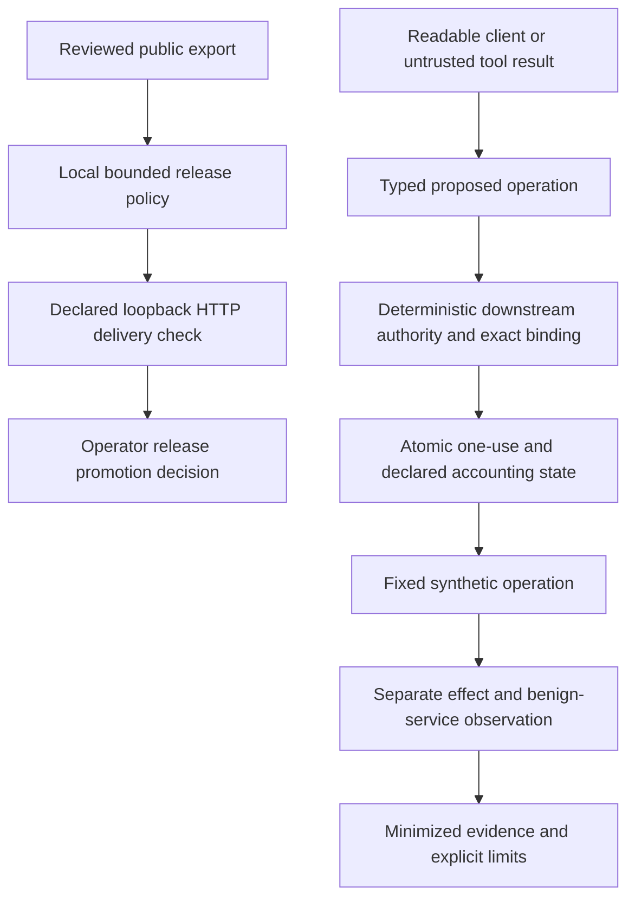

# Parallel defense methods and implemented cases

Status: **S1 synthetic effect experiments**, reviewed 2026-10-24. This increment selects three independently testable boundaries from the [PM portfolio](research/SECURITY_PORTFOLIO.md) and [BA methods/hypotheses](research/DEFENSE_METHODS_AND_HYPOTHESES.md). It does not implement the whole portfolio, add a production collector/actuator or establish real AI benefit. The [current aggregate results](lab/PARALLEL_DEFENSE_RESULTS.md), [safe evidence](lab/evidence/parallel-defense.json) and [independent challenge](research/PARALLEL_DEFENSE_CHALLENGE.md) define what actually ran.

## Cases, mechanisms and falsifiers

| PM case / BA method | Implemented mechanism | Positive and negative effect checks | Narrow result / remaining boundary |
|---|---|---|---|
| **A1 tool escalation / M01** | Fixed downstream Go HTTP operation catalog; exact typed request plus opaque bound grant checked before effect | Enforcement off permits a planted unauthorized mark; enforcement on rejects read-to-write substitution/direct invocation; approved mark changes the record and later reads observe it | Authority cannot come from tool text in this fixture. No model was exposed to an injection; no model-success probability is measured |
| **A2 confused deputy / M01, M11** | Bind identity, tenant, object, recipient and synthetic data class at the same downstream boundary | Unsafe control delivers a fixed synthetic message to the wrong inbox; protected recipient substitution has no delivery; original approved receipt reaches its correct inbox and replay fails | Fixed synthetic receiver mediation, not arbitrary secret detection, DLP or control over an authorized recipient's later behavior |
| **A3 approval laundering / M01** | Controller-only grant issuance outside HTTP, exact case/asset/operation/parameters/version/expiry binding, atomic one-use consume | Forged approval field/token, cross-agent/case reuse and malformed authority are rejected; sixteen simultaneous consumers produce one approved mark | Go state is ephemeral and single-process. A controller approval is synthetic trusted authority, not a deployed human identity/signing service |
| **W2/C2 public export / M11, H09** | Existing local exposure policy plus reviewed-reference commitment and declared HTTP identity/gzip comparison | A clean reference can pass while the server exposes a map header, stale gzip, changed root alias or a retired map; delivery checks detect those counterexamples while clean identity/gzip remain usable | Prevent promotion when wired into the release process. No route discovery, CDN audit, history recall or general private-code inference |
| **I2/W3/W2 server authority / M01, M11, H09** | Python quote authority stores token digests, grants, revocation and principal spend in shared local SQLite transactions | Consumed/revoked grants remain invalid after reopen/fresh process; two consumers cannot double-spend the last quota slot; valid quotes retain the same output; state/clock/configuration failure blocks allowance | Durable fixed-host synthetic query accounting. No production identity, distributed store, external rollback anchor or external-action reconciliation |

The engineering invariants use selected known fixtures and independent observed effects. They do not satisfy the BA proposal's larger held-out efficacy sample sizes or demonstrate coverage of H3/V3 intake, unrelated identity attacks, host compromise, exfiltration, ransomware or all 24 scenarios.

## Practical anti-REA methods

REA can reconstruct what the browser receives. The useful defense is to reduce unnecessary delivery and preserve server authority even when public routes and client structure are fully known. The [pinned REA research](research/REA_DEFENSE_RESEARCH.md) and [original before/after experiment](lab/ANTI_REA_RESULTS.md) retain successful parsing on both clients and the authorized-output inference counterexample.

1. **Minimize the complete reviewed export.** Keep private computation, credentials, development artifacts and original-source maps outside the public export. The existing bounded local policy catches selected carriers and reports inspection gaps. A pass is a policy result, not universal private-code absence.
2. **Check delivery independently of the export directory.** Compare decoded identity and gzip responses with approved reference bytes, including the root entry alias. Source-map response headers are a separate linking channel in [ECMA-426](https://tc39.es/ecma426/#sec-linking-through-http-headers); stale compressed copies can leak material even when the ordinary response looks correct. [RFC 9110 §8.4](https://www.rfc-editor.org/rfc/rfc9110.html#section-8.4) supplies the representation/content-coding distinction; the local implementation supports bounded identity/gzip only.
3. **Require explicit retirement results.** Known old map paths are tested under both requested representations. A `200` application fallback does not meet retirement policy; neither does redirecting to a different target. This measures declared paths only and does not discover every previous release or CDN object.
4. **Enforce consequential operations at the server.** Bind object, operation and canonical parameters to current known authority; endpoint names and UI buttons do not confer permission. The quote lab persists one-use state, session revocation and a principal-wide query budget rather than resetting them with a new browser session or worker.
5. **Keep oracle budgets shared and fail closed.** SQLite [explicit write transactions](https://sqlite.org/lang_transaction.html) serialize consumption and accounting for this pure calculation. Reopening the same state keeps the budget; lost/corrupt state does not silently authorize requests. A new empty state path and restoration of an old valid database remain explicit trust limits.
6. **Retain successful legitimate work and residual counterexamples.** Clean gzip, exact allowed reads, approved writes/receipts and valid quote results must still work. Two allowed outputs continue to reveal the simple synthetic formula. Quotas bound sampling; they do not prove an algorithm cannot be learned from its outputs.

No anti-debugging, parser sabotage, model poisoning, fingerprinting of REA users or obfuscation score is part of these methods. Prior downloaded information cannot be recalled. The synthetic formula is public in this repository; the measured boundary is public delivery and operation authority.

## Run the selected experiments

From the repository root with Python 3.11+ and the Go version declared in `runtime-go/go.mod`:

```text
python -m openshield release-audit YOUR_RELEASE_DIRECTORY --authorized
python -m openshield delivery-audit YOUR_RELEASE_DIRECTORY --base-url http://127.0.0.1:PORT --authorized --retired-path /retired/app.js.map
python -m openshield delivery-lab
python -m openshield anti-rea-lab
go -C runtime-go run ./cmd/shield-tool-lab
go -C runtime-go test ./...
```

The delivery command requires a separately started, explicitly authorized static preview at literal loopback. It does not start a server for an arbitrary release. The two lab commands start and stop owned synthetic fixtures. The Go command has no generic target/tool arguments, external dependencies or runtime downloads. [Tool authority results](lab/TOOL_GUARD_RESULTS.md) detail its counters and bounds; [anti-REA documentation](ANTI_REA.md) details local/delivery audit admission.

## Integration and authority



[exposure.py](../openshield/exposure.py) remains a read-only file policy. [delivery.py](../openshield/delivery.py) performs bounded HTTP GETs only against literal loopback and does not follow map URLs or redirects. [authority.py](../openshield/authority.py) serves the fixed [quote lab](../lab/anti_rea.py); [toolguard](../runtime-go/toolguard/guard.go) owns the separate fixed Go tool experiment. These are explicit entry points, not automatically enabled production integrations.

The resident Python runtime and LLM Gateway retain their existing scope, budgets and unavailable-provider status. No raw source, session/grant values or response bodies enter ordinary evidence or models through these commands. Real audit reports must not be relabelled synthetic to bypass the current timeline admission boundary. The proposal, approval, execution receipt and independent observation remain distinct.

Current local state and controller identities are trusted experimental components. Production source authentication, protected storage, TLS, off-host trust, external anti-rollback, dynamic authority propagation, availability envelopes and real AI comparisons remain unpassed capability gates.
