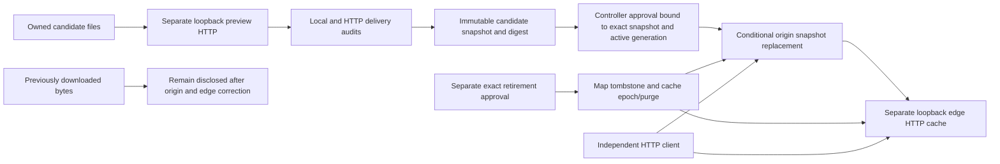

# Exact release promotion and explicit cache retirement

Status: **owned synthetic loopback experiment**, measured on 2026-10-24. This implements selected W2/C2/C3 mechanisms from the [PM portfolio](../research/SECURITY_PORTFOLIO.md), following the [REA source review](../research/REA_DEFENSE_RESEARCH.md). It is not a production deployment integration, authenticated build provenance, a full CDN purge, or a measured AI advantage.

The previous [delivery audit](PARALLEL_DEFENSE_RESULTS.md) can detect stale representations but cannot remove them. This experiment adds a real serving transition: a clean candidate is reviewed on a separate preview server, approved bytes replace the owned origin, and a separately approved retirement operation tombstones the known map route and purges the controlled edge cache. Independent HTTP requests inspect the resulting bytes.

## What actually runs



The HTTP servers have separate ports but share a process and trusted controller. The experiment does not provide process/identity isolation. Public HTTP has no grant-issuance, approval or deployment endpoint. Only the test controller invokes the mutation methods.

| Case | Implemented method | Independently observable effect |
|---|---|---|
| W2 stale source map and compressed script | Fixed identity/gzip cache keys, explicit retirement and full purge of the eight known cached representations | The private synthetic canary stops arriving on new observer requests through both controlled origin and edge |
| C2 changed candidate after approval | Local exposure policy, real preview delivery comparison, bounded immutable snapshot, current source digest recheck | A changed tree is rejected; a source edit after the final check still cannot alter the immutable bytes installed |
| C3 stale deployment/rollback approval | Exact expected generation and previous active digest, one-use ten-second grant, execution-time expiry recheck and conditional swap | A stale or competing grant cannot make a second state transition or reverse the retirement |
| Delayed pre-purge origin response | Purge epoch checked before cache insertion; retired routes take precedence | An old map fill returns 410; an old script fill returns 503 and cannot refill the clean edge |
| Historical downloaded copy | Preserve an actual pre-change HTTP response outside the controlled cache | Private bytes remain in that downloaded copy; the experiment never claims recall |

The digest identifies the approved public bytes relative to the controller's review. It does not authenticate a builder, prove that source is benign, or replace signed provenance. A new explicit approval could still approve unsafe code that this bounded exposure policy does not recognize.

## Measured effect

Each phase below independently requests `/`, `/index.html`, `/app.js` and `/app.js.map` using both identity and gzip: **eight requests per phase**. The private marker is a planted synthetic value checked only in the observer's memory. Reports contain counts/codes, never its value, source text, grant, filesystem path or server URL.

| Observed endpoint/phase | Private-canary deliveries | Required clean GETs | Denied map representations |
|---|---:|---:|---:|
| Old edge before change | 4/8 | 4/6 | 0/2 |
| Origin after exact approved promotion | 0/8 | 6/6 | 2/2 |
| Edge after promotion, before explicit purge | **4/8** | 4/6 | 0/2 |
| Edge after approved retirement and purge | **0/8** | **6/6** | **2/2** |
| Origin after retirement | 0/8 | 6/6 | 2/2 |

Promotion alone therefore fails to close delivery exposure. The separate retirement operation purges **eight cached representations**; subsequent observer requests receive exact approved page/script bytes, and both map encodings return 410. The existing delivery audit is `blocked` against the stale edge and `pass` after retirement, within the declared fixed paths only. A previously downloaded compressed map still contains the private canary after both changes.

The scenario exposes **27 named checks**, all passed locally. These are assertions about the experiment, not 27 independent attacks. Eight regression tests additionally exercise wrong-operation/forged grants, source changes, final-check races, expiry during validation, sixteen concurrent consumers of one grant with **one success**, late cache fills and stale approvals. Independent challenge adds separate HTTP observations and a distinct-grant race.

```powershell
python -m lab.promotion
python -m unittest discover -s tests -p test_promotion.py -v
```

The first command emits `promotion_lab_v1` with bounded aggregate `checks`, `phases`, `derivedFacts`, `modelCalls: 0` and `productionActions: false`. It exits nonzero if a scenario check fails. No provider, REA execution, downloaded research code, third-party target or Docker service is used by this increment.

## Fair AI/no-AI comparison inputs

The same safe observations can support a typed proposal experiment through the existing gateway. Neither branch can mint approval or alter serving authority. Correct explanations/proposals must be scored separately from the deterministic serving effects above.

| Shared derived facts | Useful bounded decision | Incorrect claim to reject |
|---|---|---|
| Candidate validation failed or approved/current digest differs | Block candidate or request a new exact review | The candidate has been promoted or made confidential |
| Origin has zero private deliveries, edge still has four | Request explicit owned-cache retirement/purge and a new postcheck | Updating origin closed the exposure |
| Edge private count zero, required clean GETs six, both map encodings denied | Verify future delivery through the declared paths; retain scope limits | Every CDN route, browser or historical copy is fixed |
| Historical downloaded response still contains private bytes | Retain the disclosure and affected-version limitation | The old implementation was recalled |

`lab.promotion.verify()` supplies corresponding booleans plus phase counts. These values are generated from measured checks rather than model verdicts. This module calls no model; any actual CLIProxyAPI comparison must report its own endpoint/model/configuration, failures, latency, validated decisions and adverse outcomes. It must not attribute the fixed gate's effect to AI.

## Limits that remain open

- Fixed known static paths and identity/gzip only. No hidden route, query alias, CDN, object-store, browser CacheStorage, source-map graph closure or service-worker implementation is validated.
- Required page/script GET bytes are checked. JavaScript execution, UI behavior, actual business transactions and production availability are not checked here.
- The trusted controller, approval ledger, origin snapshot and edge cache are in memory. Restart durability, operator authentication, TLS, privileged-host compromise and actual production conditional deployment writes remain unaccepted.
- Already started responses may finish. The purge epoch prevents a pre-purge response from refilling this cache; it cannot retract bytes already sent or downloaded.
- Changing an origin does not automatically invalidate every downstream cache. HTTP cache invalidation has defined scope; browser-managed offline response stores are another boundary. Sources: [RFC 9111, invalidation and application caches](https://www.rfc-editor.org/rfc/rfc9111.html#section-4.4), [Service Workers cache model, editor's draft](https://w3c.github.io/ServiceWorker/#cache-objects).
- A reverse engineer can still inspect all intentionally public code and infer behavior from authorized outputs. The experiment reduces selected unintended distribution and rejects unapproved release transitions; it does not make public JavaScript unreconstructable. [Pinned REA artifact reconstruction workflow](https://github.com/morluto/rea/blob/27dc42d10249f0410904a75c0997842eb03b931c/docs/javascript-artifact-reconstruction.md).
