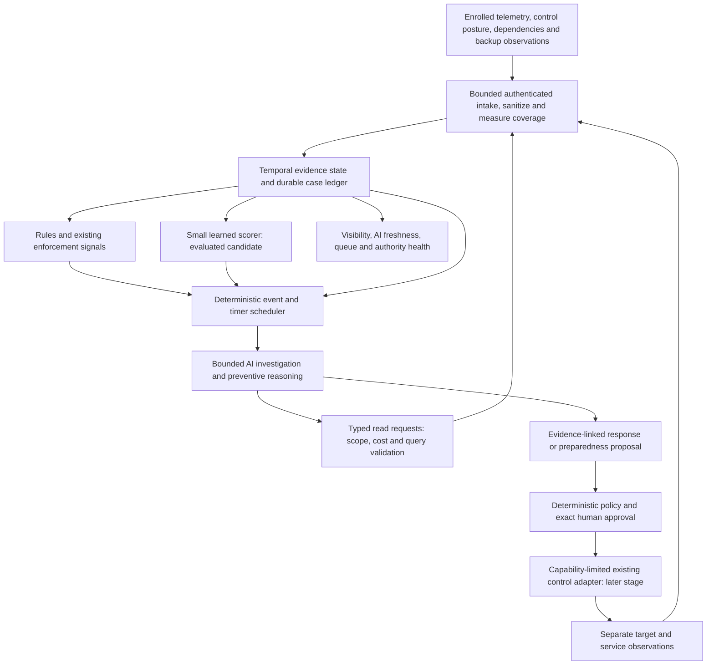

# Continuous AI defense: presence, state and control loops

Status: researched architecture proposal, 2026-10-24. No scheduler, detector, model, connector or response capability described here is implemented or benchmarked. This document proposes changes to the existing specifications; it cannot grant operational authority or override the security guardrails.

## The decision

OpenShieldAI should run an **AI-first, continuously operating defense control loop** in its intended normal mode. AI receives relevant changes to the protected environment, maintains evidence-linked hypotheses, initiates bounded read-only investigations, proposes preventive controls and response plans, and reassesses them when observations change. Its presence must be observable through run history, freshness and unresolved work, rather than a chatbot waiting for an operator to upload a report.

Continuous operation does not mean an LLM reads every packet, a model thinks without a deadline, or one agent spawns an uncontrolled fleet. Existing enforcement systems retain the fast data path. A durable deterministic coordinator schedules bounded AI work; authorization and verification use executable invariants and independently collected observations. The deterministic path remains a degraded operating mode and an experimental baseline, not a claim that AI adds no value.

| User question | Where AI belongs | What actually changes the outcome |
|---|---|---|
| Can it prevent attacks? | Continuously review observed exposure, identity/control changes, anomalous behavior and dependencies; propose specific hardening and detection changes. | An existing access policy, application fix, WAF/EDR/network control or recovery preparation is actually applied and independently tested. A reasoning result alone blocks nothing. |
| Can it respond during an attack? | Correlate evolving signals, rank competing explanations, request bounded evidence and revise a containment plan with service impact. | An enrolled enforcement point performs an authorized action; an independent observer checks threat effect and legitimate service health. |
| Can it handle the aftermath? | Reconstruct scope and persistence hypotheses; track missing evidence; plan clean restoration and interpret drill/postchecks. | Actual isolation, rebuilding, key/identity recovery and an isolated restore pass their checks. Lost data without usable backups/keys may remain lost; disclosure cannot be undone. |
| Is AI always present? | Event- and timer-driven work across preparedness, investigation, response and recovery, with durable temporal state. | Freshness guarantees, queue/budget visibility and measured improvement over existing tools establish useful presence. A resident process or repeated summary does not. |

## What primary research supports, and what it does not

The following sources inform architectural choices. None is an OpenShieldAI efficacy result. Papers, code, datasets and model weights need separate license and artifact review before reuse.

| Primary source | Relevant observation | Decision and limitation |
|---|---|---|
| [NATO AICA reference architecture, 2018](https://ccdcoe.org/uploads/2018/11/Towards_NATO_AICA.pdf) | Describes sensing/state assessment, planning/action selection, execution, learning and coordination as distinct defense functions. | Reuse the closed-loop decomposition. Its military autonomy assumptions do not authorize civilian autonomous mutation, stealth, mobile agents or hack-back. It is an architecture reference, not proof of operational efficacy. |
| [Kitsune, NDSS 2018](https://arxiv.org/abs/1802.09089v2) | Demonstrates an online network-anomaly approach using lightweight autoencoders and tracked traffic features. | Consider small learned scoring models for bounded feature streams. Anomaly is not maliciousness; local clean-baseline assumptions, drift and transfer to today's encrypted/application traffic require new evaluation. Do not route packets through an LLM. |
| [KAIROS, IEEE S&P 2024](https://spg.cs.ubc.ca/publication/2024-sp/) | Uses temporal provenance modeling to score system events and reconstruct compact intrusion footprints. | Preserve relationships and time in the evidence state; investigate a relevant subgraph rather than flattening everything into prose. Its benchmark results do not justify installing a GNN, deploying a collector or claiming production coverage. |
| [NODLINK, NDSS 2024](https://www.ndss-symposium.org/wp-content/uploads/2024-204-paper.pdf) | Studies online provenance investigation under resource and timeliness constraints. | Budget correlation, state retention and investigation together. Keep a bounded relevant evidence view while retaining references to source evidence. Reproduce utility and false-positive cost before adopting its algorithms. |
| [Sometimes Simpler is Better, USENIX Security 2025](https://www.usenix.org/conference/usenixsecurity25/presentation/bilot) | Reimplements eight provenance detectors and identifies substantial practical shortcomings; simpler models can rival more complex approaches in the evaluated settings. | Temporal state is justified; an elaborate graph-learning stack is not yet justified. Compare rules, simple statistical features, small models and any GNN on the same held-out incidents and operational metrics. |
| [SecRespond, 2026 preprint](https://arxiv.org/abs/2607.26791v1) | Evaluates post-compromise investigation and remediation planning and reports difficulty uncovering silent intrusions and complete, verified remediation. | Alert explanation must not close an incident. Explicitly test persistence, alert-free malicious activity and incomplete remediation. This benchmark does not establish safe real-world execution. |
| [Google SecOps Triage Agent documentation](https://docs.cloud.google.com/chronicle/docs/secops/triage-investigation-agent?hl=en) | Documents automatic triggers, delayed correlation, bounded investigation duration and structured investigation steps. | Automatic contextual investigation is an existing product pattern. Vendor documentation is not comparative efficacy evidence; its delays, limits and data dependencies should not be copied as Shield SLOs. |
| [NIST AI 100-2e2025](https://csrc.nist.gov/pubs/ai/100/2/e2025/final) | Covers adversarial ML, including poisoning, evasion and attacks on generative systems. | Protect data, baseline/model updates and inference/tool boundaries separately. An injection filter cannot serve as authorization. |
| [NIST SP 800-61r3, 2025](https://csrc.nist.gov/pubs/sp/800/61/r3/final) | Integrates preparation, detection, response, recovery and improvement into ongoing cybersecurity risk management. | Preparedness and post-incident follow-up belong in the same loop. Referencing the standard does not establish compliance or successful defense. |

The [Cyber Defense Benchmark](https://arxiv.org/abs/2604.19533v3) remains a useful evaluation lead, but this repository has already identified inconsistencies between its abstract and versioned PDF. Do not adopt its exact scores until reconciled; see [the existing evidence review](AI_DEFENSE_EVIDENCE.md). Open-ended SQL hunting and curated alert classification are different tasks and must have separate tests.

## Proposed control loop

The model may choose a catalog read request with typed parameters; it cannot choose a URL, inject SQL, fetch arbitrary files or acquire a credential. A deterministic query service resolves IDs against enrolled scope and permits a bounded query template. Read access needs an existing grant and budget. Unsupported evidence requests become explicit gaps rather than improvised tools.

In S1 the loop runs against a replay clock and accepted local fixtures. In S2 one actual read-only adapter supplies state changes; investigation may run automatically within its read grant. In S3 one approved action and an isolated restore drill enter the loop. This is a capability sequence, not permission to skip current stage gates.

## The state that makes AI persistent

Do not use an ever-growing prompt, chat history or embedding index as the source of truth. Maintain an ordinary versioned evidence model that can be reconstructed without a model call. SQLite tables and indexed relationships are adequate for the first pilot; a graph database is not required.

| State | Minimum semantics |
|---|---|
| Environment | Enrolled asset/service/identity IDs; observed dependencies; criticality; approved operations; control posture; owner; state/scope version. Declared dependencies and observed dependencies remain distinguishable. |
| Observation | Source event ID; source identity/trust; event/capture/receive time; clock uncertainty; entity relationships; sanitized derived facts; original opaque reference; lineage; collection gaps. |
| Behavioral reference | Feature definition; entity cohort; training/reference interval; sample count; excluded incident/change windows; model/calibration version; confidence limitations; expiry. An unfamiliar asset starts `cold_start`, never `normal`. |
| Hypothesis | Claim; supporting and conflicting evidence IDs; unresolved predictions; source independence; affected scope; latest assessment/version; next bounded read and its expected discriminating value. |
| Action state | Proposed effect, exact preconditions and authority, expected target version, approval/attempt/receipt, independent verification and compensation status. |
| AI work state | Trigger, input-state digest/version, reviewed-through event watermark, model/config version, deadlines, budget consumed, next review time and reason for incompleteness. |

Preserve event time and receive time. Late events can reopen an assessment; they cannot silently rewrite a prior approved decision. A hypothesis references an immutable state version and an explicit coverage interval. New evidence, asset drift or expired state invalidates an affected action proposal. A new assessment is appended; old decisions remain auditable.

Relationships such as process-to-file, session-to-identity or identity-to-service are observations with provenance. A model's inferred causal edge stays a hypothesis. Similar timestamps or shared IP addresses alone do not prove a causal attack chain.

## Model roles and exact outputs

These are bounded use cases behind one LLM Gateway, not permanently running autonomous agents. One coordinator owns the case; it invokes roles sequentially unless an independently measured task benefits from bounded parallelism.

| Role | Input | Typed output | Forbidden interpretation |
|---|---|---|---|
| Learned event scorer, candidate | Minimized numeric/categorical features, source health, reference-model version. No prompts. | Score, feature/window refs, calibration/cohort, `cold_start`/out-of-distribution status. | Its score is neither breach probability nor an authorization to block. Simple statistical baselines must be compared too. |
| Investigator | New evidence delta, relevant prior facts/hypotheses, coverage, approved read catalog and dependency context. | Competing claims with evidence for/against, affected scope, typed missing-evidence requests and explicit uncertainty. | No invented evidence, generic organization-wide hunting or unsupported incident closure. |
| Preventive control reasoner | Versioned posture/control changes, known dependencies, observed behavior and reviewed control catalog. | Specific gap, plausible attack consequence, proposed control, business trade-off and a reproducible validation plan. | A generic best-practice checklist is not a prevention result. |
| Response/recovery planner | Evidence state, service/identity dependencies, allowed playbooks, available backup/key metadata and current action state. | Catalog proposal, preconditions, narrow parameters, impact, alternatives, postchecks and compensation or irreversible-procedure flag. | No new tools, commands, privileges or restoration guarantee. |
| Challenger | Proposed claim/action, direct evidence refs, benign alternatives and service constraints. | Contradictions, unsupported assumptions, missing checks and reasons to defer. | Agreement with another model is not independent verification. |
| Outcome interpreter | Actual observer evidence and deterministic check results. | Explanation, residual risks, failed/inconclusive checks and next bounded investigation. | It cannot change a failed check to verified success or authorize reconnection. |

The existing aliases can remain configurable; domain code should use these typed roles/use cases rather than hardcode a model family. A new role must earn its latency/cost through an ablation. The learned scorer is a separate predictive model interface, not an LLM alias disguised as one. No particular ML architecture is selected by this document.

## Scheduling, latency and resource bounds

The numbers below are **initial pilot experiment parameters**, not measured performance, commitments or production defaults. A pilot ADR must freeze supported environment, source latency, hardware, model route, budgets and accepted harm/availability envelope before implementation acceptance.

| Trigger | Proposed scheduler behavior | Visible failure/deadline |
|---|---|---|
| Known high-risk detection from existing rules/control | Make the signal visible immediately; enqueue bounded AI work without intentional batching. Existing protection does not await an LLM. | Measure source-to-intake, intake-to-alert, queue wait and AI completion separately. An AI timeout must not suppress the original alert. |
| Relevant event delta | Coalesce up to 5 seconds for the same case/state; perform one assessment for the new watermark. | Show unreviewed-through time and queued work. Do not restart a run on every event. |
| Feature windows | Evaluate accepted feature/model candidates at 10-second ticks over 1-minute/15-minute/24-hour windows where supported. | Missing/partial windows reduce visibility; they are not filled with fabricated zero activity. |
| Active incident | Reassess on material new evidence, action outcome or dependency change; otherwise a 60-second freshness check schedules only useful work. | Persist a pending delta while one run owns the case lease; no concurrent plan races. |
| Preventive posture | Reassess on deployment, identity, control, dependency or backup-readiness change; a 15-minute check detects missed source updates. | The check can report unchanged state without another inference. Known gaps retain owner, age and next review. |
| Noisy/low-priority state | Delay up to 30 minutes and run a bounded sampled audit of suppressed candidates. | Publish sampling coverage and estimated misses separately. Sampled monitoring is not full recall. |
| Recovery observation | Run catalog checks at their procedure-specific intervals; AI interprets changed results and outstanding hypotheses. | RPO/RTO include source, action, waiting and verification time, including approvals. |

Proposed pilot run ceiling: 180 seconds total wall time, at most eight model calls, at most two investigation rounds and three typed read requests per round. A single model call has a 30-second timeout and output limit of 2,000 tokens. Aggregate per-run input/output limits are 64,000/8,000 tokens with a maximum of 16,000 input tokens per call; calls stop when any ceiling is reached. One permitted transient retry consumes these same ceilings. These are ceilings, not a promise that every step can run before the total deadline.

First-pilot concurrency is one active run per case and two model calls globally, with one slot reserved for an urgent incident when queued. Use bounded queues with duplicate coalescing and per-source quotas; an event flood must not create one LLM job per event. Denied/deferred triggers and oldest unreviewed state remain visible. Critical evidence and audit are retained independently of inference admission. When capacity is exceeded, escalate a coverage gap, preserve durable pending work and stop claiming continuous AI review within its target age.

Response time has separate clocks: attack occurrence to available telemetry, telemetry to detection, queue/investigation, approval, execution and verification. Only instrumented measurements can establish each interval. Per-action human approval can be slower than an automated attacker. Existing preconfigured controls supply immediate protection; if they cannot contain the threat, the first Shield releases cannot honestly promise machine-speed containment. Any future standing emergency authority requires a separate owner-approved architecture/policy decision and capability-specific tests.

## Degradation must be explicit

Health is multidimensional: model availability, inference freshness, telemetry coverage, authority, enforcement health and verifier health can fail independently.

- **Normal AI mode:** permitted AI route is available, state freshness and queue targets hold, useful model outputs pass validation, and source coverage is acceptable for the declared capability.
- **AI degraded:** timeout, refusal, invalid references, budget stop or disallowed route. Deterministic detection and existing controls continue; new AI-dependent claims/plans are incomplete. Show the last reviewed state and backlog. Never silently send restricted data to another provider.
- **Visibility degraded:** stale/compromised/missing collector, event loss or clock uncertainty. Preserve known facts and existing protections; mark affected hypotheses and verification inconclusive. Normal model availability does not restore visibility.
- **Authority suspended:** policy/audit/approval/secret-broker failure or kill switch. Stop new mutation dispatch, retain evidence and reconcile in-flight actions. Read-only work continues only if its own authorization remains valid.
- **Overload:** bounded queue or latency target exceeded. Apply documented admission/fairness policy, preserve high-value evidence and alert the operator to unreviewed scope. Do not discard hard alerts because the model budget is exhausted.

On recovery, resume from a durable watermark and frozen case version. Reconcile actions and expired authority before dispatch; replayed inputs do not re-execute actions. An old AI conclusion cannot overwrite a newer evidence version.

## Attack resistance and model lifecycle

Treat logs, source labels, retrieved procedures and tool output as adversarial. Sanitization/data labels reduce exposure but do not make text trustworthy. Parse bounded fields, separate facts from instructions, use a reviewed read/playbook catalog, and validate every output/reference and action boundary outside the model. Test instructions hidden in log fields, poisoned tool results, malicious retrieved documents, forged case IDs and requests to disable audit.

Use operator-accepted, versioned reference windows. Quarantine incident/suspicious windows from automatic baseline updates; an attacker must not teach the system that malicious behavior is normal merely by repeating it. Deployment and workload changes can also create legitimate drift. Keep change annotations, peer/cohort uncertainty, shadow evaluation and rollback of model/config updates. No online self-modification of model weights, policy or executable catalog in initial releases. Analyst feedback is an untrusted labeled input pending review, not immediate training truth.

Do not pool organization data across tenants or train on incident evidence implicitly. Training, calibration, inference, retrieval and evaluation each have their own permission, retention and provenance. A local model still receives minimized data; local placement does not remove injection, privacy or poisoning risk.

## Experiments that decide whether this architecture is useful

Extend [the existing evaluation plan](../EVALUATION.md) with chronological, continuous replay and source failures. Keep identical telemetry visibility, action authority and resource envelopes across variants.

1. Existing deployed tools/rules; then deterministic correlation and playbooks; then a simple learned scorer; then bounded LLM investigation; then preventive reasoning/challenge individually. Add a GNN only if simpler variants miss a measured need.
2. Place benign deployment/backup/identity changes between sparse and slow attack steps. Test quiet persistence, multi-stage escalation, late/duplicate events, telemetry loss and poisoned baseline periods. Split by incident/campaign/environment/time, never random neighboring rows.
3. Report incident recall and benign escalation burden, time to correct scope, unsupported claims, useful missing-evidence requests, false closure, analyst review effort and total cost. Quantify AI's incremental benefit and harm against each baseline; summary fluency and token volume are not outcomes.
4. Measure event-to-review age, p50/p95 queue/completion time, coverage under flood, fairness, watchdog recovery and inference resource use. Include incidents that admission policy deferred; evaluating only accepted jobs hides overload misses.
5. For prevention, measure independently observed blocked attack effect and bypasses together with legitimate service success. For response, measure attack progression/loss before verified containment and collateral harm. For recovery, perform the isolated restore and application checks; include unavailable/corrupt backups and missing keys.
6. Test model outage, evidence injection, stale state, invalid references, output refusal, failed verification and adversarial update attempts. Any authority bypass, secret leak, evidence loss or false verification blocks release regardless of average utility.

An experiment may conclude that a model role is not worth deploying. AI-first is a product hypothesis about sustained useful reasoning; it is not a requirement to retain an ineffective role or replace proven deterministic controls.

## Gaps to resolve in the normative specifications

| Existing document | Missing decision this research exposes |
|---|---|
| PRD / acceptance | Calling AI merely optional does not express the requested normal operating mode. Define mandatory AI-loop acceptance separately from useful deterministic degraded operation; keep S0/S1 claims honest. |
| Architecture | Add persistent environmental/temporal state, scheduler triggers/watermarks, source-quality health, freshness/overload and read-query boundary. Distinguish the reasoning/control loop from the enforcement data path. |
| Data contracts | Define versioned observation relationships, reference/baseline state, AI-run freshness/budget, typed read requests and proposal invalidation on material evidence/state change. |
| LLM Provider specification | Distinguish model roles and non-LLM scorers, approved predictive-model artifacts, per-run/period budgets, model freshness and explicit degraded behavior. Avoid recursive agents. |
| Worker / operations | Freeze concrete deadlines, source admission/fairness, durable leases, coalescing, cancellation/recovery and operator escalation before pilot release. |
| Evaluation / production readiness | Add continuous chronological replay, AI ablations, quiet intrusions, poisoning/drift, overload and source-to-verified-effect clocks. Decide accepted limits with the pilot owner; no paper supplies universal production thresholds. |

Research completed here: source-backed design and testable hypotheses. Not performed: code integration, model training, benchmark replication, deployment or real incident response; efficacy and source-compromise resilience remain unproven.
