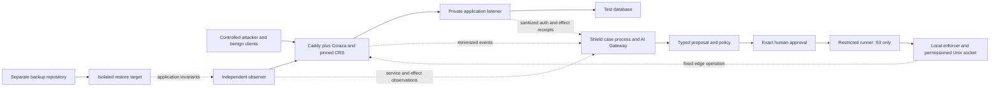

# Defensive control points and the first proof environment

Reviewed: **2026-10-24**. Status: **S0 research and proposed experiments; no connector, enforcement, detection or recovery has been implemented or tested by OpenShieldAI.** This document narrows the existing architecture to observable control points. It does not enable execution or supersede the security gates.

## What the four questions require

| Question | A defensible answer must name | Evidence that would establish the claim |
|---|---|---|
| Can it prevent an attack? | The specific attack effect, the inline enforcement point, its configuration, and every route around it | The effect occurs with the control absent, is prevented with it enabled, and legitimate requests still work |
| Can it respond while an attack continues? | Fresh observations, a bounded response action, its authority, its effect on attacker activity and legitimate service | Independent traffic/target observations before and after the action; command success is insufficient |
| Can it handle the aftermath? | Exposure scope, persistence uncertainty, credential recovery, usable recovery point and clean restoration destination | An actual isolated restore plus application checks; preserved evidence and unresolved exposure remain visible |
| Where is AI continuously present? | A persistent case process that revisits changed evidence, gaps, plans and verification results | Evidence-linked revisions with measured benefit over deterministic rules; blocking must continue when AI is unavailable |

The current repository answers these questions as a design. It does not yet demonstrate any of the four operationally. AI availability and defensive efficacy are separate measurements.

## Evidence-to-claim table

Primary sources were checked on the review date. Documentation URLs may change; immutable connector/source references below identify the inspected code. None of these sources supplies an OpenShieldAI performance result.

| Source | Observed upstream mechanism | Architectural consequence / prohibited inference |
|---|---|---|
| [Coraza connector catalog](https://www.coraza.io/connectors/) | Coraza has specific server/proxy connectors, including Caddy | The Go WAF library alone is not an enrolled reverse proxy or a complete deployment |
| [coraza-caddy README, pinned commit](https://github.com/corazawaf/coraza-caddy/blob/e268cf0f44e95d64da81c641aabebd21364be6f1/README.md) | `coraza_waf` precedes other HTTP handlers using `order coraza_waf first`; `load_owasp_crs` exposes embedded `@` rule paths | A real connector and rule-loading order must be tested. An installed package or missing include is not protection |
| [Connector dependency file, same commit](https://github.com/corazawaf/coraza-caddy/blob/e268cf0f44e95d64da81c641aabebd21364be6f1/go.mod) | Explicit engine, server and embedded-rule dependencies | A separately inspected engine HEAD and CRS HEAD are not a compatible build tuple |
| [Coraza directives](https://www.coraza.io/docs/seclang/directives/) | `DetectionOnly` does not execute disruptive actions; `On` is needed for blocking; body processing has limits | Observe-only output cannot be called prevention. `ProcessPartial` leaves uninspected bytes; the docs mark `SecRequestBodyNoFilesLimit` unimplemented, so it cannot supply our upload safety claim |
| [CRS anomaly scoring](https://coreruleset.org/docs/2-how-crs-works/2-1-anomaly_scoring/) | Rule matches accumulate a score; blocking evaluation is separate. Response blocking happens after backend handling | A match is not necessarily a block. Blocking a response does not undo a database change already performed by the request |
| [CRS tuning](https://coreruleset.org/docs/2-how-crs-works/2-3-false-positives-and-tuning/) | Generic rules need application exclusions; matching data can contain secrets | Replay legitimate traffic and sanitize at the source boundary. Blanket exclusions and higher thresholds can remove useful protection |
| [Caddy proxy trust](https://caddyserver.com/docs/caddyfile/options#trusted-proxies) | No proxies are trusted by default; trusted proxy ranges and strict parsing affect client-IP extraction | Never trust arbitrary forwarded headers. A spoofed client address can make a response block the wrong user |
| [Connector client-address implementation](https://github.com/corazawaf/coraza-caddy/blob/e268cf0f44e95d64da81c641aabebd21364be6f1/utils.go) | Uses Caddy's parsed client-IP variable where available, otherwise the connection address | Pin and test this actual connector behavior, including IPv6 and proxy chains, rather than assuming all log IP fields mean the same thing |
| [Connector request processing](https://github.com/corazawaf/coraza-caddy/blob/e268cf0f44e95d64da81c641aabebd21364be6f1/http.go) | Request phases precede downstream processing; partially inspected remaining body bytes can continue downstream | Test parsing/limit behavior against the selected application. Reject modes, content types and limits form part of coverage |
| [Connector response processing](https://github.com/corazawaf/coraza-caddy/blob/e268cf0f44e95d64da81c641aabebd21364be6f1/interceptor.go) | WebSocket upgrades hand the connection off and skip subsequent HTTP-response processing | Do not claim inspection of arbitrary messages after upgrade. Streaming, WebSocket and gRPC need separate acceptance |
| [Connector logging](https://github.com/corazawaf/coraza-caddy/blob/e268cf0f44e95d64da81c641aabebd21364be6f1/coraza.go) | Error callback uses matched-rule error text; violation logging includes request URI | An ingestion sanitizer cannot erase a raw password already written upstream. Isolate upstream sensitive logs and minimize before exporting |
| [Caddy API](https://caddyserver.com/docs/api) | Local administration API supports configuration reads/changes and ETag/If-Match collision detection; permissioned Unix sockets are documented | The API is powerful authority, not an LLM tool. A scoped runner must limit operations and refuse state drift; an API success response is not traffic verification |
| [Caddy advisory GHSA-879p-475x-rqh2 / CVE-2026-27589](https://github.com/caddyserver/caddy/security/advisories/GHSA-879p-475x-rqh2), published 2026-02-23 | Cross-origin local-admin configuration changes were confirmed at the advisory's stated source commit; patched version is `v2.11.0` | Loopback alone is not an authorization boundary. Inspect advisories for the actual resolved build and isolate administration; being above this patch does not establish overall security |
| [OWASP credential-stuffing prevention](https://cheatsheetseries.owasp.org/cheatsheets/Credential_Stuffing_Prevention_Cheat_Sheet.html) | MFA and layered signals address credential attacks; distributed low-rate traffic can evade IP limits | IP denial is one temporary measure. It does not establish account security, stop stolen valid sessions or replace application/identity controls |
| [OWASP authorization](https://cheatsheetseries.owasp.org/cheatsheets/Authorization_Cheat_Sheet.html) | Authorization is distinct from authentication and must be checked for each requested resource/action | A syntactically normal authenticated IDOR request may pass CRS. Fix object-level policy in the application; do not market the WAF as that fix |
| [Falco event sources](https://falco.org/docs/concepts/event-sources/) and [dropped events](https://falco.org/docs/concepts/event-sources/kernel/dropped-events/) | Linux kernel events can produce runtime rule alerts; capture can drop events | A later existing-sensor adapter must report loss/heartbeat. An alert does not stop a process or prove host cleanliness |
| [restic restore, documentation observed as 0.19.1](https://restic.readthedocs.io/en/stable/050_restore.html) | Restores a selected snapshot to a target; existing destination files are overwritten by default | Resolve an immutable full snapshot ID and an empty isolated destination; never use `latest` or an arbitrary target in an approved restore |
| [restic repository checks, 0.19.1](https://restic.readthedocs.io/en/stable/045_working_with_repos.html) | Snapshot listing and data/integrity checks are separate operations | A listed snapshot is readiness metadata, not proof that data can be restored or an application can run |
| [restic threat model, pinned source](https://github.com/restic/restic/blob/dd09b6bd01af220b1d5d95c0d4d7d472e05e05c4/doc/design.rst) | Compromised clients and backup-storage trust are explicit concerns | Keep backup administration separate. Encryption does not ensure clean snapshots, deletion resistance or recovery after key loss |
| [NCSC DoS response guidance](https://www.ncsc.gov.uk/collection/denial-service-dos-guidance-collection/a-minimal-denial-of-service-response-plan) | Provider defenses and available infrastructure capacity affect DoS response | A local WAF cannot recover capacity on an already saturated upstream link; escalation to the operator's upstream provider is a real dependency |
| [nftables element timeouts, revision 500, 2020-04-06](https://wiki.nftables.org/wiki-nftables/index.php?title=Element_timeouts&oldid=500) | Kernel sets support expiring elements | Possible later alternative for a direct-edge network control. It is not selected or enabled here; source-IP semantics, privileges and IPv4/IPv6 tests differ from HTTP controls |

## Proposed first environment: one Linux web service

Use an isolated lab with an operator-deployed Caddy/Coraza edge, a small application with authentication and a persistent test dataset, a separate observer, and an existing backup repository. Keep Shield on a separate management host/VM. The first telemetry adapter is bounded ingestion of the edge's exported observations; adding Falco or an identity-provider executor is a later decision, not a prerequisite hidden in this lab.

### Routing prerequisites that decide whether the shield exists

The protected application listens only on loopback, an isolated private interface reachable from the edge, or a permissioned Unix socket. Enforce this with listener bindings and network rules, not DNS alone. Check IPv4, IPv6, container-published ports, alternate hostnames, legacy ingress, admin paths and internal routes. A CDN path needs explicit origin restrictions and correct client-IP trust; it is outside the first direct-edge lab. Management and backup paths must remain separate from the response path.

The direct-origin negative test is mandatory: a controlled client attempts the same effect through every declared alternate listener. If any bypass succeeds, the claim is only about traffic that traverses the WAF. Do not present that result as protection of the application as a whole.

### Inspected dependency tuple, not a tested recommendation

The connector's `main` commit was `e268cf0f44e95d64da81c641aabebd21364be6f1`, committed **2026-10-15T12:28:11Z**, when queried through the official GitHub API. Its dependency file declares:

| Artifact | Inspected declaration |
|---|---|
| Connector | `github.com/corazawaf/coraza-caddy/v2` at the immutable commit above |
| Toolchain | Go `1.26.0` |
| Caddy module | `v2.11.4` |
| Coraza engine | `v3.8.1` |
| Embedded Coraza configuration module | `coraza/v3 v3.8.1` |
| Embedded CRS module | `crs/v4 v4.30.0` |

The latest release endpoints separately reported connector `v2.6.2` published **2026-10-08T11:22:30Z** and Caddy `v2.11.7` published **2026-10-03T05:58:33Z**. These observations do not mean the connector HEAD contains those exact release contents or that upgrading a transitive dependency is compatible. The implementation task must choose release/commit pins, resolve the full build graph, record binary/image digests and license notices, and run connector end-to-end plus CRS regression tests. Do not independently substitute the registry's Coraza/CRS HEAD references into the embedded bundle.

The inspected Caddy dependency is above the `v2.11.0` patch listed by [GHSA-879p-475x-rqh2](https://github.com/caddyserver/caddy/security/advisories/GHSA-879p-475x-rqh2). The advisory reports its affected source commit rather than a complete numeric vulnerable range. No reproduction code was downloaded or run. This is one advisory check, not a dependency-security audit or a declaration that the tuple is acceptable for production.

### What enters the decision process

Export a minimized event envelope: enrolled edge/workload ID, collector identity, configuration digest, request/transaction correlation ID, observed and ingested timestamps, route template, method, status, rule IDs, score/phase, disposition, bounded size/latency metadata and source coverage. The app supplies separate synthetic effect receipts, such as whether a protected database row changed. Use pseudonymous actor/account references if needed. Never export raw query strings, request bodies, passwords, authorization headers, cookies or raw matched data to ordinary Shield logs or models.

Forensic originals, if the operator explicitly collects them, remain in restricted operator storage. Secret canaries must test upstream access/error/audit logs as well as ingestion, model/error paths and exports. Configuration of a sanitizer after the WAF does not by itself satisfy this condition.

## Prevention and ongoing-response experiment

Start with a fixed operator-reviewed ruleset in observe mode to collect compatibility evidence, then enable blocking only in the isolated lab. The protected data path is deterministic: request arrives, the preinstalled policy evaluates it, and the connector either stops or forwards it. No model call or human approval sits on that per-request path. Changing that policy is a separate privileged operation.

The selected first response experiment is **ingress maintenance for one enrolled lab site**, instantiated from a fixed catalog template. Stop new requests to that site's declared application routes with a fixed maintenance response while management, observer and backup channels remain separate. This deliberately interrupts legitimate use of that site: classify it as R2 only inside the owner's explicitly accepted low-impact lab envelope. An essential/shared/production service or unknown dependency exceeds that envelope and requires the higher-impact human-run procedure. It is not host isolation, an account revocation action or a recovery operation. The previously researched single-IP denial remains an unselected alternative: shared NAT, proxy attribution and distributed actors make it a weaker first proof action.

For the Caddy route, the broker sends a typed capability to a narrow local enforcer; only that process can reach the permissioned Caddy administration Unix socket. No model, public API handler, browser page or general Shield worker receives generic administration access. The enforcer reads the known configuration and ETag, verifies the expected version, replaces only the enrolled site's existing owned route slot with the exact reviewed maintenance template, and uses If-Match on that single mutation. A `412` means fresh planning/approval, not silent retry with expanded authority. The runner cannot submit arbitrary Caddy JSON, change listeners, disable the WAF on other routes, alter trust ranges, use `/stop`, or reach the application/backup administration interfaces.

The [API documentation](https://caddyserver.com/docs/api) states that a failed `/load` leaves the old working configuration, but multiple configuration requests are not one transaction. Use one approved bounded mutation rather than assuming an ETag makes a multi-request rollout atomic. Restrict Unix-socket filesystem access and process identity, and test denial from the untrusted application, ordinary worker and local browser contexts.

**Time and restoration caveat:** the inspected Caddy API is not a lease service. A grant's expiry ends permission to dispatch; it does not revert an already accepted route. `reviewDue` schedules an owner review/escalation and must not silently reopen an attacked site. Persist the control's actual observed state through enforcer/broker restart. Restoring the exact owned route is a separately authorized compensating action after state/impact checks; concurrent edits forbid overwriting the saved old configuration wholesale. A temporary IP-rule alternative would need its own proved expiry posture and durable cleanup, or a separately reviewed native-expiry control.

Before dispatch, persist intent plus exact scope, parameters, expected state, action hash, grant expiry, review due time and verification plan. After an ambiguous response, read back the specific route and reconcile; never repeat a mutation blindly. A configuration reload success is merely an execution receipt. The observer must send controlled new requests to the site's application routes, confirm expected maintenance, check management/unaffected services and inspect the independent application effect receipt. Legitimate requests to the maintained site are expected to fail within the accepted interruption envelope. No attacker payload is sent to an unowned host.

| Lab case | Expected observation | Claim / counterexample |
|---|---|---|
| Selected request-phase attack pattern against a harmless vulnerable fixture | Control-off effect occurs; control-on request is blocked before app effect; benign traffic succeeds | Supports only this pattern, connector, configuration and fixture |
| Same pattern in `DetectionOnly` | Alert can exist while the app effect still occurs | Exposes false prevention claims based on alerts |
| Authorized resource ID swapped between two fixture accounts | Request may pass generic CRS; application ownership policy must reject it | WAF coverage does not equal authorization coverage |
| Repeated attack traffic, then site maintenance | New application requests receive maintenance; management and unaffected services remain available | Demonstrates site ingress suppression with deliberate legitimate-service interruption, not account recovery |
| Low-rate abuse from multiple actors / stolen valid session | Single-address denial is insufficient | Requires identity/application controls and different visibility |
| Rule approved, then edge changes before execution | Dispatch is denied on stale state | Tests the authority boundary rather than attack detection |
| Response lost after edge accepted change | Outcome is unknown until readback and probes reconcile it | Tests duplicate/ambiguous mutation handling |
| Broker dies after maintenance was applied | Actual route state is reconciled; grant expiry/review due does not silently reopen service | If this fails, live release is blocked |
| App is compromised and starts outbound traffic | An ingress-only denial may leave activity running | Cannot claim host isolation, persistence removal or exfiltration containment |
| Link saturation or edge CPU/body-buffer exhaustion | Availability can fail before Shield can act | Local controls are bounded by capacity; no volumetric-DDoS claim |

### Exact conditional target operation: source evidence, not a runtime result

The Caddy `v2.11.4` annotated tag peels to immutable commit **`e2eee6a7fce366321294c9c2a79f3146891dcbdf`**, tag date **2026-06-03T03:54:40Z**, verified using official GitHub tag/content APIs. Its source establishes this candidate conditional path:

1. The local enforcer obtains `GET /config/` over the permissioned Unix socket. It retains the **exact quoted** root `Etag` header, the expected known route template and a separate cryptographic action/config digest; raw configuration does not enter the model or logs. [GET handler and ETag generation](https://github.com/caddyserver/caddy/blob/e2eee6a7fce366321294c9c2a79f3146891dcbdf/admin.go#L1006).
2. For a pre-enrolled example site slot, submit **`PATCH /config/apps/http/servers/shield-lab/routes/0`**, `Content-Type: application/json`, `If-Match: <the unchanged exact root Etag>`. The body is the fixed compiled maintenance template for that known site, never model-authored JSON. The real server/slot/path is frozen by enrollment and approval; `shield-lab` and slot `0` are illustrative, not a deployed route. [Handler forwards If-Match](https://github.com/caddyserver/caddy/blob/e2eee6a7fce366321294c9c2a79f3146891dcbdf/admin.go#L1035); [PATCH replaces an existing array slot](https://github.com/caddyserver/caddy/blob/e2eee6a7fce366321294c9c2a79f3146891dcbdf/admin.go#L1248).
3. `changeConfig` obtains `rawCfgMu.Lock()` and defers unlock **before** reading the If-Match scope/hash. A mismatch returns HTTP **412** before mutation; otherwise it mutates, encodes, loads the new configuration and updates the stored representation inside that lock. The ETag may cover `/config/` even when the mutation targets a narrower descendant, so dependency/topology edits also invalidate the approved state. [Lock, condition, 412 and mutation](https://github.com/caddyserver/caddy/blob/e2eee6a7fce366321294c9c2a79f3146891dcbdf/caddy.go#L158); [load/revert/stored-state path](https://github.com/caddyserver/caddy/blob/e2eee6a7fce366321294c9c2a79f3146891dcbdf/caddy.go#L245).
4. **Do not use `/load` for conditional execution.** In this inspected version its handler calls `caddy.Load(body, forceReload)`, whose path passes an empty If-Match into `changeConfig`; a preliminary read followed by `/load` is not the target-side conditional operation. [Load handler](https://github.com/caddyserver/caddy/blob/e2eee6a7fce366321294c9c2a79f3146891dcbdf/caddyconfig/load.go#L114); [Load call into changeConfig](https://github.com/caddyserver/caddy/blob/e2eee6a7fce366321294c9c2a79f3146891dcbdf/caddy.go#L136).

This source inspection resolves which endpoint has a target-held concurrency check. It does not satisfy the S3 runtime gate. Test concurrent edits, reordering/deleting the enrolled slot, lost responses, process crash, failed provisioning, readback, socket permissions and independent traffic outcomes on the actual pinned binary. The ETag is an opaque concurrency token using a noncryptographic hash; it is not a signed approval, an asset identity or a replacement for the broker's cryptographic action digest. It protects the checked configuration snapshot, not arbitrary host state or the truth of telemetry.

### Existing requests and WebSockets are a separate impact dimension

A new ingress rule does not establish cancellation of already accepted backend work, transaction rollback or termination of persistence/egress. Conversely, **do not promise that changing Caddy configuration preserves all existing connections**: upstream documents that proxy WebSockets close on reload by default, with behavior modified by `stream_close_delay`. The pinned version declares this setting and invokes connection cleanup when unloading the proxy. [Official streaming behavior](https://caddyserver.com/docs/caddyfile/directives/reverse_proxy#streaming); [pinned setting](https://github.com/caddyserver/caddy/blob/e2eee6a7fce366321294c9c2a79f3146891dcbdf/modules/caddyhttp/reverseproxy/reverseproxy.go#L180); [cleanup](https://github.com/caddyserver/caddy/blob/e2eee6a7fce366321294c9c2a79f3146891dcbdf/modules/caddyhttp/reverseproxy/reverseproxy.go#L440).

The initial low-impact fixture excludes live customer streams. Long-running HTTP requests, WebSockets and delayed background effects remain explicit negative controls: measure whether they continue, close or reconnect under the selected actual configuration, disclose collateral effects, and never infer host/session containment from their outcome. Any decision to terminate streams or broaden isolation is a different impact/authority decision.

## AI's persistent role and time budget

A durable case loop receives evidence changes and source-health events, updates the timeline and deterministic baseline, and schedules bounded AI analysis. AI correlates actors/routes/auth outcomes, compares benign deployment versus compromise hypotheses, identifies missing evidence, proposes a known response, challenges its service impact, and later interprets observer/restore evidence. Each revision cites immutable evidence IDs, coverage and contrary observations. AI cannot approve, publish rules, access credentials or assert successful containment without independent observations.

Use coalesced evidence windows and priority queues so alert floods do not create one paid model call per request. Protect reserved compute/queue capacity for source health, approval, kill switch and reconciliation. Low-priority analysis may be dropped/coalesced with a visible gap; control-plane exhaustion never grants new authority. The fixed inline defense keeps its last accepted policy during AI outage. Source loss means `visibility_gap`, not “no attack.”

Exploratory alternatives considered were **a five-second aggregation window, one concurrent analysis per case, a 15-second total model deadline including the gateway's permitted retry, and a 60-second analysis refresh only when relevant evidence changes or a hypothesis/evidence request remains open**. These are not the selected requirements: the [operating architecture](../OPERATING_ARCHITECTURE.md) and [LLM specification](../LLM_PROVIDER_SPEC.md) define the canonical pilot schedule and episode limits. No alternative is observed performance or an approved production SLO. Per-request WAF overhead, queue growth and false-positive disruption require measurements before any numerical efficacy claim.

Record separate clocks: `t_effect_started`, `t_source_observed`, `t_ingested`, `t_baseline_ready`, `t_ai_ready`, `t_proposed`, `t_approved`, `t_dispatched`, `t_control_observed` and `t_effect_verified`. Publish p50/p95/worst case and event loss, with synchronized-clock uncertainty. Report human wait separately. “AI response in seconds” cannot include neither ingestion lag nor human wait. No architecture diagram makes a human-approved control instantaneous.

## Aftermath and recovery proof

After site ingress suppression, investigate alternate sessions, changed files, persistence indicators, reachable secrets/data and outbound activity using the available evidence; state what is unavailable. A WAF action does not clean a host. Credential/session revocation is a later separate identity adapter with lockout/recovery procedures; it is not a reversible edge-rule compensation. Root compromise requires a human-controlled clean rebuild and identity recovery procedure rather than AI deleting suspicious files in place.

For data loss, Shield first reads backup metadata through a separate low-privilege identity. A later approved drill binds the full selected snapshot ID, expected repository, separate decryption/access path and empty isolated destination to the action. The restore runner has no production write path, backup deletion/prune authority or permission to reconnect the restored app. Validate expected records, referential/business invariants, application startup, clean-network behavior and sample read/write transactions. Check relevant persistence indicators without claiming exhaustive malware absence. Measure recovery point from the last independently verified recoverable application state and recovery time from a declared drill start to validated service readiness; distinguish drill readiness from production reconnection.

Missing keys, corrupt/incomplete snapshots, inconsistent database copies, compromised snapshots and unobserved dwell time are explicit failed/inconclusive cases. Restoring an old copy can restore persistence and vulnerable software. Recovery cannot reverse data exfiltration, identify all affected parties without evidence, or reconstruct data that never reached a usable backup.

## Decisions still requiring implementation evidence

1. Supported Linux distribution/kernel, connector build tuple, TLS topology, request content types, upload/streaming policy, capacities and service SLOs are unselected. No cross-environment support claim follows from this research.
2. Source logging must be minimized/isolated without leaking matched secrets; verify actual release defaults and error paths. A paper configuration is insufficient.
3. Site-maintenance dispatch requires the source-identified conditional `/config/` path and runtime concurrency/failure tests; the `/load` path is unsuitable for CAS. Grant expiry and review due cannot silently revert its effect. Compensation and connection behavior need explicit impact evidence before the action is eligible for a live envelope.
4. The first source adapter cannot observe every host action, identity event or outbound disclosure. Importing existing Falco/auth/egress sources broadens evidence only after their own bounded parser, permission, freshness and efficacy tests.
5. AI's incremental value, resource cost, latency and adverse proposals are unmeasured. Compare identical held-out cases under fixed rules/manual playbooks, rules plus AI, and rules plus AI with challenge. Keep negative controls, missing-telemetry cases and injected-log instructions.
6. No upstream is installed by this research. S1 remains offline replay; S2 is read-only; brokered response and isolated restore wait for S3 gates. OpenHunterAI collaboration follows standalone proof.
